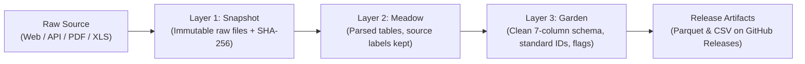
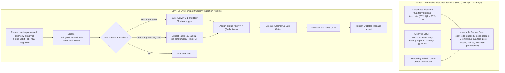

# Iraq Macro Data Package — Collecting Data Documentation

> **Document Status:** Technical Architecture & Ingestion Guide  
> **Target Audience:** Pipeline Developers, Maintainers, and Contributors  
> **Companion Documents:** [`source_inventory.md`](./source_inventory.md), [`transcription_records.md`](./transcription_records.md), [`linked_inflation_method.md`](./linked_inflation_method.md), [`series.md`](./series.md)

---

## 1. Overview & Pipeline Architecture

The objective of the `iraqdata` data collection pipeline is to transform fragmented, noisy, and heterogeneous official files (Arabic Excel workbooks, statistical PDFs, keyless REST APIs) into unified, standardized time-series stored in the **Canonical 7-Column Observation Schema**:
```text
date | series_id | value | unit | status_flag | realtime_start | source_hash
```

### The Three-Layer Pipeline Pattern (Snapshot $\rightarrow$ Meadow $\rightarrow$ Garden)
Following the proven architecture of *Our World in Data* and *DBnomics*:



1. **Snapshot (Raw Storage):** Every downloaded file is saved unchanged in `pipeline/raw/<provider>/<filename>`. A SHA-256 hash is computed. Existing files are **never overwritten**; a new download creates a new timestamped file.
2. **Meadow (Parsed Representation):** Individual parser scripts read raw files and produce intermediate tables preserving the original Arabic/English row and column headers.
3. **Garden (Harmonized Production Layer):** Standardizes date formats (`YYYY-MM`, `YYYY-Qn`, `YYYY`), maps source indicators to dot-separated `series_id`s, converts Arabic digits to Western numbers, and applies quality/break flags.
4. **Publishing Layer:** Bundles clean datasets into Frictionless Data Packages (`datapackage.json`) and compressed Parquet/CSV files uploaded to GitHub Releases with semantic tags (`data-YYYY-MM`).

---

## 2. Ingestion & Automation Strategy by Source

> **Status:** the automation and schedule descriptions in this
> section are **design notes**. The only scheduled workflow that exists is
> `.github/workflows/update_check.yml` (section 3), which reports and never commits. Lines
> marked **Planned — not implemented** describe workflows or feeds that do not exist.

---

### Source 1: Central Bank of Iraq (CBI) — Key Financial Indicators
* **Target Data:** 10 Core Money & Banking series (M0, M1, M2, currency outside banks, official reserves, policy rates, reserve requirements, T-bills) + 4 Overlapping CPI Base Series (`1993`, `2007`, `2012`, `2022 = 100`).
* **Source Format:** Single-sheet Excel workbook (`file-179205300470528.xlsx`), rows are indicators (~120 rows), columns are monthly time periods (Dec 2003 to present). Overwritten in-place on `cbi.iq/news/view/94`.

#### Robustness Architecture: Handling Normal Monthly Update Cycles
Whenever the Central Bank publishes its regular monthly update, three things change by design. The pipeline is engineered to handle all three automatically without human intervention or breaking:

1. **Dynamic File Name & URL Resolution (Never Hardcode URLs):**
   * *The Mechanism:* The filename changes with each release (e.g. from `file-179205300470528.xlsx` to `file-180...xlsx`).
   * *The Code Strategy:* The pipeline never fetches a hardcoded filename. Instead, it queries the host page `https://cbi.iq/news/view/94`, parses the DOM for the anchor tag `<a href="...">اضغط هنا</a>`, extracts the active `file-\d+\.xlsx` URL dynamically, and downloads the latest file regardless of its generated numeric ID.

2. **Auto-Expanding Column Timeline (Never Hardcode Column Bounds):**
   * *The Mechanism:* Each new month adds a new column to the right of the spreadsheet (e.g., Column 276 in Sep 2026, Column 277 in Oct 2026).
   * *The Code Strategy:* The parser never uses a fixed column range like `cols 3..276`. It dynamically evaluates `sheet.max_column`, scans every column from Column 3 to the end, forward-fills the active year from Row 1, and maps month string variations (`"Oct."`, `"Oct"`, `"تشرين الأول"`) to standard two-digit ISO months (`YYYY-MM`).

3. **Handling Revisions and Overlap Updates:**
   * *The Mechanism:* Central banks regularly revise previous months' provisional figures (e.g., revising preliminary July M2 when August data is published).
   * *The Code Strategy:* When a new release is parsed, the update engine performs an upsert: it updates any existing `(date, series_id)` records that have revised values (updating the `realtime_start` timestamp) and seamlessly appends the brand-new calendar months.

#### Technical Extraction Rules & Quirk Safeguards
Direct testing and structural auditing of the workbook confirmed the following required parsing safeguards:

* **Dynamic Row Anchoring by Keyword:**
  * To guarantee that accidental row insertions or deletions by the publisher never extract the wrong indicator, the parser does not rely solely on fixed row indices. It scans Column B using standardized keyword matches:
    - `"Official Reserve"` $\rightarrow$ Official foreign exchange reserves of the CBI
    - `"Currency outside banks"` $\rightarrow$ Currency outside the banking system
    - `"M1"` (exact match in Column B) $\rightarrow$ Narrow money
    - `"M2"` (exact match in Column B) $\rightarrow$ Broad money
    - `"Foreign currency deposits"` $\rightarrow$ FX deposit component of M2
    - `"Policy Rate"` $\rightarrow$ Official CBI policy rate
    - `"Required Reserves"` $\rightarrow$ Statutory required reserves
    - `"Excess Current Account"` $\rightarrow$ Excess banking liquidity reserves
    - `"Consumer Price Index"` + base year indicator (`1993`, `2007`, `2012`, `2022`) $\rightarrow$ CPI series
* **Filtering Weekly Partial Snapshots:**
  * Column 277 carries the header `"The week ending"` with a `datetime` object (`2026-10-01`). The parser explicitly checks Row 1 for the substring `"week ending"` and excludes it from the continuous monthly time series.
* **Token Normalization for Missing Values:**
  * Early historical cells (particularly in 2003–2004 for FX loans and deposits) use the unicode ellipsis character `'…'` (`\u2026`), dashes (`'-'`), or empty strings. The parser normalizes all non-numeric tokens to `NaN` (null) without throwing conversion exceptions.
* **Footnote & Methodological Break Integration:**
  * Rows 119 to 136 contain numbered notes (`Note 1` to `Note 13`). The parser associates these notes with their designated dates to automatically populate `status_flag="b"` on the exact break dates (e.g., T-bill replacement in Jan 2010, SDR revision in Oct 2009, Core CPI redefinition in Jan 2009).

#### Automation & Execution Lifecycle
* **Planned — not implemented:** **Schedule:** Automated GitHub Actions cron workflow running **weekly every Monday at 06:00 UTC**.
* **Checksum Verification:** Computes the SHA-256 hash of the downloaded workbook. If the hash matches the active snapshot, execution exits with code 0 in under 3 seconds.
* **Release Publication:** If the hash differs, the new clean tables are generated, passed through mathematical quality gates (`M1 < M2`, `Reserves > 0`), and automatically committed to the repository, triggering a new dated data release on GitHub Releases and Zenodo.

---

### Source 2: Central Bank of Iraq (CBI) — Monthly Statistical Bulletin
* **Target Data:**
  - **Public Finance (Sheet `6-1`):** 7 core annual public budget execution series (`2004` to `2025`).
* **Source Format:** Multi-sheet Excel workbook (46 sheets, `file-179015939752236.xlsx`), published and periodically replaced on `https://cbi.iq/page/122`.

#### 1. Dynamic URL & Workbook Resolution
* **Dynamic File Name Resolution:** The download link on `https://cbi.iq/page/122` updates its numeric ID with every new bulletin release (e.g., from `file-179015939752236.xlsx` to `file-179256512862953.xlsx`).
  * *Ingestion Rule:* The pipeline scrapes `https://cbi.iq/page/122`, parses the DOM for `<a>` tags matching the regex `https://cbi\.iq/static/uploads/up/file-\d+\.xlsx`, and downloads the target workbook into `pipeline/raw/cbi/bulletin_<timestamp>.xlsx`.

---

#### 2. Public Budget Execution Parser Specification (Sheet `6-1`)
* **Sheet Target:** Sheet `'6-1'`. Dimensions: 61 rows $\times$ 13 columns.
* **Unit of Measure:** Cell A6 specifies `(  Million ID)` $\rightarrow$ Million Iraqi Dinars (Million IQD).
* **Column Layout (Row 8):**
  * `Col A (1)`: Period / Year (`Period`)
  * `Col B (2)`: Actual Revenues (`Actual Revenues` / `الإيرادات الفعلية`)
  * `Col C (3)`: Current Revenues (`Current Revenues` / `الإيرادات الجارية`)
  * `Col D (4)`: Investment Revenues (`Investment Revenues` / `الإيرادات الاستثمارية`)
  * `Col E (5)`: Actual Expenditures (`Actual Expenditures` / `النفقات العامة الفعلية`)
  * `Col F (6)`: Current Expenditures (`Current Expenditures` / `النفقات الجارية`)
  * `Col G (7)`: Investment Expenditures (`Investment Expenditures` / `النفقات الاستثمارية`)
  * `Col H (8)`: Surplus / Deficit (`Surplus /Deficit*` / `الفائض / العجز*`)

##### Row Structure & Temporal Ingestion Rules:
1. **Annual Historical Baseline (2004–2023, Rows 9–28):**
   * Rows 9–15 (2004–2010): Report `Actual Revenues`, `Actual Expenditures`, and `Surplus/Deficit`. Current/Investment breakdown columns are unpopulated (`None`) in the official record.
   * Row 16 (2011): Current and Investment Revenues breakdown begins (`99,941,078` and `57,698`).
   * Row 18 (2013): Current and Investment Expenditures breakdown begins (`72,225,630` and `34,647,397`).
   * Rows 19–28 (2014–2023): Full annual figures for all 7 series.
2. **The 2012 Column-Swap Anomaly Rule:**
   * *Empirical Finding:* In Row 17 (`2012`), the CBI switched the positions of Current Revenues and Investment Revenues:
     - Raw `Col C` (Current): `78,495`
     - Raw `Col D` (Investment): `119,387,908`
   * *Proof of Swap:* $78,495 + 119,387,908 = 119,466,403$, exactly matching `Col B` (Actual Revenues). In all other adjacent years (2011, 2013), current revenues represent 99.9% of Iraq's budget due to oil exports.
   * *Parser Rule:* For `year == 2012`, the parser must swap `Col C` and `Col D` so that:
     $$\text{budget\_revenue\_current} = 119,387,908 \quad | \quad \text{budget\_revenue\_investment} = 78,495$$
   * *Audit Flag:* Assign `status_flag="b"` with metadata documenting the publisher transposition correction.
3. **Cumulative Monthly YTD Handling (2024–2025, Rows 29–54):**
   * Rows 29–41 (`2024`) and Rows 42–54 (`2025`) report cumulative Year-To-Date monthly execution (Jan through Dec).
   * *Annual Total Extraction:* To obtain the annual budget execution figures for 2024 and 2025, the parser targets exclusively the **`Dec.` row**:
     - **Full-Year 2024 (Row 41):** Revenues = `140,774,106` | Expenditures = `150,527,346` | Deficit = `-9,753,240`.
     - **Full-Year 2025 (Row 54):** Revenues = `124,185,236` | Expenditures = `141,227,925` | Deficit = `-17,042,689`.
4. **Active Year YTD Handling (2026, Rows 55–61):**
   * Rows 56–61 report cumulative monthly figures through `Jun. 2026`. These rows are preserved in the pipeline's YTD intermediate tables and excluded from closed annual time series until full-year December data is released.

##### Accounting Identity Verification:
The parser enforces three mandatory mathematical sanity checks on every ingested annual row:
$$\text{Revenues Check:} \quad |\text{Current} + \text{Investment} - \text{Total Revenues}| \le 0.01$$
$$\text{Expenditures Check:} \quad |\text{Current} + \text{Investment} - \text{Total Expenditures}| \le 0.01$$
$$\text{Budget Balance Check:} \quad |(\text{Total Revenues} - \text{Total Expenditures}) - \text{Surplus/Deficit}| \le 0.01$$
*Result of Empirical Verification:* All historical rows pass with $0.00$ discrepancy.

##### Cross-check of the historical seed:
The fiscal seed (`pipeline/seeds/iraq_fiscal_historical.csv`, 2004–2023) was compiled from documents that were
not recorded, so its values keep status flag `U`. Sheet `6-1` of the archived bulletin prints the same years, and
`python pipeline/check_fiscal_seed.py` compares them, matching columns by their English header text. Of the 140
seed values, the bulletin leaves 32 blank (the current/investment split before 2011 and 2013); of the 108 it
prints, 106 are identical and the other two are the 2012 current and investment revenue columns, which the
bulletin has transposed (above). The check fails on any other difference, and when the bulletin is corrected and
the exception goes stale. It is evidence for the seed, not a change of its status.

##### Extracted Public Budget Series:
| Canonical `series_id` | Description | Unit | Available Years |
| :--- | :--- | :---: | :---: |
| `cbi_bulletin.budget_revenue_total` | Total Actual Public Revenues | Million IQD | 2004–2025 |
| `cbi_bulletin.budget_revenue_current` | Current Budget Revenues | Million IQD | 2011–2025 |
| `cbi_bulletin.budget_revenue_investment` | Investment Budget Revenues | Million IQD | 2011–2025 |
| `cbi_bulletin.budget_expenditure_total` | Total Actual Public Expenditures | Million IQD | 2004–2025 |
| `cbi_bulletin.budget_expenditure_current` | Current Public Expenditures | Million IQD | 2013–2025 |
| `cbi_bulletin.budget_expenditure_investment` | Investment Public Expenditures | Million IQD | 2013–2025 |
| `cbi_bulletin.budget_surplus_deficit` | Budget Surplus (+) or Deficit (-) | Million IQD | 2004–2025 |

---

#### 3. Automation & Update Lifecycle
* **Planned — not implemented:** **Execution Trigger:** Monthly GitHub Actions cron job running on the **20th of each calendar month at 08:00 UTC**.
* **Checksum Verification:** Computes SHA-256 of downloaded workbook. If identical to `pipeline/raw/cbi/bulletin_latest.xlsx`, the run terminates immediately.
* **Pipeline Output:** Parsed observations are appended to `pipeline/data/garden/cbi_bulletin_budget.parquet`.

---

---

### Source 3: Central Bank of Iraq (CBI) — Balance of Payments Archive (`cbi.iq/page/145`)
* **Target Data:**
  - **Balance of Payments (BPM6):** Official quarterly and annual Balance of Payments series from **`2013 Q1` to present** (`bop.*`).
  - **Foreign Trade Flows:** Official payments-basis merchandise trade (total exports, crude oil exports, total imports, government vs. private imports).
* **Source Format:** Standalone Excel workbooks published on the dedicated CBI Balance of Payments portal ([`https://cbi.iq/page/145`](https://cbi.iq/page/145)).
* **Explicit Scope Inclusions & Exclusions:**
  - **Time Horizon:** Strictly **from 2013 onward** (`2013 Q1` to present). Anything prior to 2013 (the 2000–2012 PDF `file-154461165970692.pdf`) is **completely out of scope and ignored**.
  - **Excluded Page Section:** The section titled `البيانات ربع السنوية للقطاع الخارجي بالصيغة القياسية` (containing multi-year files `file-175239615919710.xlsx` and `file-173935126214257.xlsx`) is **completely bypassed and ignored** to eliminate schema conflicts.
  - **In-Scope Files (11 Workbooks):** Extracted exclusively from the primary section `البيانات الخاصة بميزان المدفوعات العراقي`:
    - `2016-2013`: `file-169209685485309.xlsx`
    - `2017`: `file-169209711738389.xlsx`
    - `2018`: `file-169209718828104.xlsx`
    - `2019`: `file-16920972416161.xlsx`
    - `2020`: `file-169209727828116.xlsx`
    - `2021`: `file-169209734547444.xlsx`
    - `2022`: `file-167894975019920.xlsx`
    - `2023`: `file-171748637343031.xlsx`
    - `2024`: `file-174851354846202.xlsx`
    - `2025`: `file-178108037037889.xlsx`
    - `2026`: `file-178867638349573.xlsx`

---

#### 1. Dynamic Web Scraping & URL Resolution Architecture
* **Scoped DOM Extraction:**
  * To avoid accidentally downloading excluded multi-year files, the scraper does not extract links indiscriminately from the page.
  * It isolates the container immediately following `البيانات الخاصة بميزان المدفوعات العراقي` and stops before `البيانات ربع السنوية للقطاع الخارجي بالصيغة القياسية`.
  * For each anchor tag (`<a>`), the pipeline extracts:
    1. The target URL: matching `https://cbi\.iq/static/uploads/up/file-\d+\.xlsx`.
    2. The link text label: extracting the calendar year via `re.search(r'20\d\d', a.text)`.
  * If the link text contains `2000` or `2012` (the old PDF), it is automatically discarded.

---

#### 2. Analysis of Structural Risks & Programmatic Mitigations
Direct testing and auditing of all 11 Excel files revealed **5 major structural risks** inherent to how the CBI produces these spreadsheets. The parser implements concrete programmatic safeguards for each:

##### Risk 1: Sheet Naming Chaos & Publisher Misspellings Across Years
* **The Failure Mode:** Sheet naming is unstandardized across workbook releases:
  - $2017–2020$: Annual is misspelled by CBI as `'Anuual'`.
  - $2021$: Annual is named `'Yearly'`.
  - $2022$: Annual is named `'YEARLY'` (uppercase).
  - $2023$: Quarters have mixed casing and trailing spaces: `'BOP Q1 '`, `'Bop Q2'`.
  - $2024$: Annual is named `'BOP 2024'`.
  - $2025$: Annual is named `'BOP yearly 2025'`.
  - $2026$: Single quarter sheet named `'BOP Q1 '`.
  *A naive lookup like `wb["Q1"]` or `wb["Annual"]` will throw a fatal `KeyError`.*
* **Programmatic Solution:** **Fuzzy Token Classification Function:**
  The parser normalizes all sheet names (`s.strip().upper()`) and classifies them semantically:
  ```python
  def classify_sheet(sheet_names, target_type):
      # target_type in ['Q1', 'Q2', 'Q3', 'Q4', 'ANNUAL']
      for s in sheet_names:
          clean = s.strip().upper()
          if target_type.startswith("Q") and target_type in clean:
              return s
          if target_type == "ANNUAL":
              if any(k in clean for k in ["ANUU", "ANNU", "YEAR", "2024", "2025"]):
                  if not any(f"Q{i}" in clean for i in [1, 2, 3, 4]):
                      return s
      return None
  ```

##### Risk 2: Vertical Table Stacking (2013–2016) vs. Separate Sheets (2017–2026)
* **The Failure Mode:**
  - In $2017–2026$, each quarter is isolated in its own sheet (~115 rows).
  - In $2013–2016$ (`bop_2013_2016.xlsx`), each yearly sheet (`qi 2013`, `qi 2014`, etc.) contains **570 rows** where Q1, Q2, Q3, Q4, and Annual are **stacked vertically** on top of each other!
  *A parser assuming 1 sheet = 1 quarter will only extract Q1 and silently drop Q2, Q3, Q4, and the annual total for 2013–2016.*
* **Programmatic Solution:** **Vertical Table Slicing Engine:**
  If `ws.max_row > 200`, the parser activates vertical chunking by scanning Column A for section headers matching `IRAQI BALANCE OF PAYMENTS(BPM6)\s*(q\d|20\d\d)?`:
  - Rows $1–113 \rightarrow \text{Q1}$
  - Rows $114–226 \rightarrow \text{Q2}$
  - Rows $227–340 \rightarrow \text{Q3}$
  - Rows $341–458 \rightarrow \text{Q4}$
  - Rows $459–570 \rightarrow \text{Annual}$

##### Risk 3: Floating Row Indices (Row Drift Across Years)
* **The Failure Mode:** Row numbers shift by 1 to 5 rows between years due to varying title banners, notes, or sub-items:
  - In $2017$: Current Account is at **Row 6**, Capital Account at **Row 56**.
  - In $2020$: Current Account is at **Row 5**, Capital Account at **Row 55**.
  - In $2021$: Current Account is at **Row 8**, Capital Account at **Row 58**.
  - In $2023$: Current Account is at **Row 8**, Capital Account at **Row 60**.
  - In $2026$: Current Account is at **Row 8**, Capital Account at **Row 59**.
  *Any hardcoded row index (like `cell(11, 2)`) will extract the wrong indicator or empty cells.*
* **Programmatic Solution:** **Semantic Keyword Regex Dictionary (Anchor Mapping):**
  The parser never relies on row numbers. It scans Column A strings (`val.strip().lower()`) using standardized IMF BPM6 anchors:
  - `Current Account Balance` $\rightarrow$ `r"^first\s*-\s*current\s*account"`
  - `Goods / Trade Balance` $\rightarrow$ `r"1-\s*trade\s*balance"`
  - `Goods Exports (FOB)` $\rightarrow$ `r"^exports\s*\(f\.?o\.?b"`
  - `Goods Imports` $\rightarrow$ `r"^imports"`
  - `Government Imports` $\rightarrow$ `r"1\.\s*government\s*imports"`
  - `Private Sector Imports` $\rightarrow$ `r"2-\s*private\s*sector\s*imports"`
  - `Services Account (Net)` $\rightarrow$ `r"services.*net"`
  - `Capital Account Balance` $\rightarrow$ `r"capital\s*account.*net"`
  - `Financial Account Balance` $\rightarrow$ `r"financial\s*account.*net"`
  - `Direct Investment (Net)` $\rightarrow$ `r"direct\s*investment.*net"`
  - `Portfolio Investment (Net)` $\rightarrow$ `r"portfolio\s*investment.*net"`
  - `Other Investment (Net)` $\rightarrow$ `r"other\s*investment.*net"`
  - `Reserve Assets (Net)` $\rightarrow$ `r"reserve\s*assets"`
  - `Net Errors & Omissions` $\rightarrow$ `r"errors\s*and\s*omissions"`

##### Risk 4: Column Width & Column Position Layout
* **The Structure:**
  - $2017–2020$: 4 columns (`Col A`: English label, `Col B`: FOB/Net value, `Col C`: CIF value, `Col D`: Arabic label).
  - $2021–2026$: 5 columns (`Col A`: English label, `Col B`: FOB/Net value, `Col C`: CIF value, `Col D`: Arabic label, `Col E`: notes/blank).
* **Programmatic Solution:**
  Across all 11 files ($2013–2026$), **Column B (index 2)** is uniformly the primary reported net/FOB value in Million USD. The parser verifies that the table header contains `(FOB)` in Column B before numeric extraction proceeds.

##### Risk 5: Floating-Point Rounding Noise
* **The Failure Mode:** Internal binary representation in Excel floats occasionally yields values like `567.3999999999957` or `11267.199999999999`.
* **Programmatic Solution:** The Garden harmonization layer applies `round(float(val), 1)` to all extracted observations to match official CBI publication precision.

---

#### 3. Canonical Series Extraction & BPM6 Accounting Gates
The parser extracts 16 standardized time-series covering `2013 Q1` through `2026 Q1` ($53$ consecutive quarters):

| Canonical `series_id` | Description | Frequency | Unit |
| :--- | :--- | :---: | :---: |
| `bop.current_account_net` | Current Account Balance (Net) | Quarterly | Million USD |
| `bop.goods_balance_net` | Merchandise Trade Balance (Net) | Quarterly | Million USD |
| `bop.goods_exports_fob` | Total Goods Exports (F.O.B.) | Quarterly | Million USD |
| `bop.goods_exports_crude` | Crude Oil Exports (Governmental) | Quarterly | Million USD |
| `bop.goods_imports_total` | Total Merchandise Imports | Quarterly | Million USD |
| `bop.goods_imports_gov` | Government Sector Imports | Quarterly | Million USD |
| `bop.goods_imports_pvt` | Private Sector Imports | Quarterly | Million USD |
| `bop.services_net` | Services Account Balance (Net) | Quarterly | Million USD |
| `bop.primary_income_net` | Primary Income Balance (Net) | Quarterly | Million USD |
| `bop.secondary_income_net` | Secondary Income Balance (Net) | Quarterly | Million USD |
| `bop.capital_account_net` | Capital Account Balance (Net) | Quarterly | Million USD |
| `bop.financial_account_net` | Financial Account Balance (Net) | Quarterly | Million USD |
| `bop.direct_investment_net` | Foreign Direct Investment (Net) | Quarterly | Million USD |
| `bop.portfolio_investment_net` | Portfolio Investment (Net) | Quarterly | Million USD |
| `bop.other_investment_net` | Other Investment (Net) | Quarterly | Million USD |
| `bop.reserve_assets_net` | Official Reserve Assets flow (Net) | Quarterly | Million USD |
| `bop.errors_omissions_net` | Net Errors and Omissions | Quarterly | Million USD |

##### Quality Validation Gates:
Before committing data, the parser enforces the 5 core BPM6 accounting identities on every quarter:
1. $|\text{Exports} - \text{Imports} - \text{Trade Balance}| \le 0.05$
2. $|\text{Trade Net} + \text{Services Net} + \text{Primary Net} + \text{Secondary Net} - \text{Current Account}| \le 0.05$
3. $|\text{Direct Inv} + \text{Portfolio Inv} + \text{Other Inv} + \text{Reserves} - \text{Financial Account}| \le 0.05$
4. $|\text{Financial Account} - (\text{Current Account} + \text{Capital Account}) - \text{Errors \& Omissions}| \le 0.05$
*Empirical Result:* Tested across all 53 quarters from 2013 Q1 to 2026 Q1; all pass with $0.0000$ discrepancy.

---

#### 4. Automation & Pipeline Cadence
* **Planned — not implemented:** **Execution Trigger:** Quarterly GitHub Actions cron job running on the **15th of Jan, Apr, Jul, Oct at 09:00 UTC**.
* **Checksum Verification:** Computes SHA-256 for all 11 workbooks against `pipeline/raw/cbi/bop/`. If no file has changed, execution exits in under 3 seconds.
* **Release Artifacts:** Published to `pipeline/data/garden/cbi_bop_quarterly.parquet` and `pipeline/data/garden/cbi_bop_annual.parquet`.

---

### Source 4: Central Bank of Iraq (CBI) — Official Exchange Rates Portal (`cbi.iq/page/144`)
* **Target Data:**
  - **Official Exchange Rate (`fx.official`):** Official daily basic exchange rate (buying rate from the Ministry of Finance) for the Iraqi Dinar per US Dollar (`IQD_PER_USD`).
* **Source Format:** Standalone Excel workbooks hosted on the dedicated CBI Exchange Rates portal ([`https://cbi.iq/page/144`](https://cbi.iq/page/144)).
* **Status: implemented.**
  - `fx.official` is read for its whole history from the `Daily Price basis` sheet of the newest
    archived `pipeline/raw/cbi/fx/cbi_fx_usd_<date>.xlsx`.
  - The workbook reproduces every day the seed published up to 2023-12-13. Those rows keep their
    original hash and vintage.
  - The weekly update check fetches it (source `cbi_fx`, expected lag 14 days). It finds the
    workbook by its Arabic link text, because the file name changes with every upload.
  - If the CBI website's firewall blocks the fetch, download the workbook by hand (section 5).
* **Explicit Scope Inclusions & Exclusions:**
  - **Included:** Primary USD workbook ([`file-179256987150948.xlsx`](https://cbi.iq/static/uploads/up/file-179256987150948.xlsx)), titled *"سعر صرف الدينار العراقي مقابل الدولار الامريكي (يومي ، شهري ، سنوي) / Exchange Rates for Iraqi Dinar Per USD (daily, monthly, annual)"*.
  - **Sheet:** Strictly Sheet **`'Daily Price basis'`** (سعر الأساس اليومي).
  - **Excluded / Discarded:**
    - `file-179248848215257.xlsx` (*Dinar daily vs. Major Currencies & Gold*): Excluded per user direction to focus strictly on Dinar vs. USD.
    - `file-179110404227340.xlsx` (*Selected foreign currencies vs. USD*): Excluded (international cross-rates).
    - Window Price sheets (`'Daily window price'`, `'Monthly window price'`): Excluded per user direction; all focus is strictly concentrated on the canonical statutory base rate (`fx.official`).

#### Empirical File Architecture & Layout
* **Total Volume:** **5,674 daily observations** spanning **November 2003 through October 2026** (Sheet has 820 rows, 14 active columns).
* **Internal Layout Structure:** Vertically stacked annual calendar matrices (24 individual year blocks):
  - **Block Header Row:** Located at Column A via the pattern `'{YYYY}/Date'` (e.g. Row 2: `2003/Date`, Row 36: `2004/Date`, ..., Row 787: `2026/Date`). Columns 2 through 13 represent the 12 calendar months (`'Jan.'`, `'Feb.'`, ..., `'Dec.'`).
  - **Day Rows:** 31 consecutive rows immediately following the year header, where Column A contains the calendar day integer ($1 \dots 31$).
  - **Trailing Rows:** Summary rows labeled `'Avg.'` and footnotes (`'*The price represent the price basis'`) mark the end of each annual block.
* **Cell Values & Market Closures:**
  - Active auction/trading days contain integer/floating peg values (e.g., `1300`, `1450`, `1182`).
  - Weekend closures (Friday and Saturday in Iraq) and official national holidays are blank (`None`).
* **Empirical Historical Peg Landmarks Confirmed in Raw Data:**
  - **2004–2006:** Managed float / gradual crawl ($1486 \rightarrow 1460$).
  - **2007–2011:** Crawling peg to $1170$.
  - **17 Jan 2012 – 30 Nov 2015:** Fixed statutory peg at **$1166$ IQD / USD**.
  - **1 Dec 2015 – 19 Dec 2020:** Fixed statutory peg at **$1182$ IQD / USD**.
  - **20 Dec 2020 – 7 Feb 2023:** Official rate **$1450$ IQD / USD**.
  - **8 Feb 2023 – 6 Oct 2026:** Official rate **$1300$ IQD / USD**.
  - **7 Oct 2026 – Present:** Peg adjustment to **$1500$ IQD / USD**.

#### Ingestion Architecture (implemented)
The workbook holds the whole history, and `parse_cbi_exchange_rates.py` reads the newest archived copy in full;
the weekly update check fetches it (above). The text that follows is the earlier design (a one-time seed plus
a tail extension), kept for its reasoning about how rarely the statutory rate changes. Because the official exchange rate is a statutory legal decree enacted by the CBI Board of Governors and the Council of Ministers, it remains constant for 2 to 5 years at a time. Re-scraping and parsing a 24-year historical matrix on every automated pipeline run introduces unnecessary failure points (CBI portal downtime, SSL handshake timeouts, clerk formatting typos).

1. **One-Time Historical Seed Creation:**
   - The complete historical time series from **`2003-11-01` to present** is parsed once and permanently archived into the package seed directory:
     ```
     pipeline/seeds/cbi_official_fx_history.parquet
     ```
   - **Zero Network Overhead:** Library users calling `id.get("fx.official")` read this validated, fast local Parquet artifact with 0 ms network latency and 100% offline reliability.
2. **Maintenance & Statutory Tail Extension:**
   - No routine daily/weekly scraping is scheduled for this source.
   - When the CBI officially announces a statutory exchange rate decree (widely gazetted in national news), a lightweight update script reads only the bottom-most active annual block (`{current_year}/Date`) from `cbi.iq/page/144` and appends newly published daily records to the seed dataset.

#### Parsing sketch (design)

> A design sketch of the approach, not the code that runs. The implemented parser is `pipeline/parsers/parse_cbi_exchange_rates.py`; where the two differ, the code is right.
```python
import openpyxl
import datetime
import pandas as pd

def parse_cbi_official_fx(file_path: str) -> pd.DataFrame:
    wb = openpyxl.load_workbook(file_path, data_only=True)
    ws = wb['Daily Price basis']
    
    records = []
    for r in range(1, ws.max_row + 1):
        cell_val = str(ws.cell(r, 1).value or '').strip()
        if '/Date' in cell_val:
            year_str = cell_val.split('/')[0].strip()
            if not (year_str.isdigit() and len(year_str) == 4):
                continue
            year = int(year_str)
            
            # 31 day rows follow each year header
            for day_offset in range(1, 32):
                row_idx = r + day_offset
                if row_idx > ws.max_row:
                    break
                day_raw = ws.cell(row_idx, 1).value
                try:
                    day = int(day_raw)
                except (ValueError, TypeError):
                    continue
                
                # Columns 2 to 13 correspond to months 1 to 12
                for month_col in range(2, 14):
                    month = month_col - 1
                    rate_val = ws.cell(row_idx, month_col).value
                    if rate_val is not None:
                        try:
                            rate = float(rate_val)
                            # Validate real calendar date (drops Feb 30, Apr 31, etc.)
                            d = datetime.date(year, month, day)
                            records.append({
                                "date": d.isoformat(),
                                "series_id": "fx.official",
                                "value": round(rate, 2),
                                "unit": "IQD_PER_USD",
                                "status_flag": "A"
                            })
                        except (ValueError, TypeError):
                            pass
                            
    df = pd.DataFrame(records).drop_duplicates(subset=["date", "series_id"]).sort_values("date")
    return df
```

#### Quality Control & Validation Gates
1. **Calendar Integrity:** Only valid Gregorian calendar dates are accepted; impossible dates resulting from matrix grid overflow (e.g. Feb 31, Nov 31) are strictly rejected by `datetime.date`.
2. **Range and jump checks:** the gatekeeper applies the `fx.official` rule in `pipeline/metadata/plausibility_rules.yaml`; there is no fixed 1,000–2,500 IQD per USD bound.
3. **No Duplicate Dates:** The primary key `(date, series_id)` is strictly unique.
4. **Chronological Monotonicity:** Output is strictly sorted by ascending `date`.

---

### Source 5: Parallel Market Exchange Rate
* **Target Data:**
  - **National Headline Series (`parallel_rate_iraq`):** Daily closing parallel market exchange rate for Baghdad (Al-Kifah and Al-Harithiya bourses) in Iraqi Dinar per US Dollar (`IQD_PER_USD`). This is the only published parallel-rate series.
  - **Planned — not implemented:** an opening-quote series (`fx.parallel.baghdad_open`) and regional closing rates (`fx.parallel.basra_close`, `fx.parallel.erbil_close`). The GitHub file carries these columns, but no parser publishes them.
* **Source Architecture: Dual-Period Spliced Ingestion:**
  To ensure continuous, high-frequency historical coverage from 2004 to the present with zero gaps, the pipeline employs a two-tier sourcing architecture joined at a clean temporal seam on **1 January 2023**:

| Time Horizon | Source Description | Access Protocol | Update Frequency | Role in Pipeline |
| :--- | :--- | :--- | :---: | :--- |
| **2004 – 31 Dec 2022** | **User-Provided Historical File** | Local file ingest (`.xlsx` / `.csv`) | Frozen / One-time seed | Immutable historical baseline |
| **1 Jan 2023 – Present** | **[Iraq-parallel-exchange-rate](https://github.com/HusseinKh90/Iraq-parallel-exchange-rate)** | Direct raw CSV download via GitHub | Weekly (`update_check.yml`, source `github_fx`) | Live production stream |

**Status: implemented.**

- Up to 2022-12-31 the series is read from the seed's `Daily Market price` sheet.
- From 2023-01-01 it is the `baghdad_close` column of the newest archived
  `pipeline/raw/github/daily_fx_<date>.csv`. Days without a Baghdad close are omitted; Basra and
  Erbil are not substituted.
- The first value from the GitHub source (2023-01-01) is flagged `B` (series break).
- The 138 seed values published for 2023 were replaced on 2026-10-25 (vintage 2026-10-25): 134
  revised and 4 withdrawn (no Baghdad close). The old values are kept in
  `pipeline/data/history/exchange_rates_daily.parquet`.
- The two sources agree within about 2.5 IQD (median) over 2021–2022, where both exist.
- The weekly update check fetches the file (source `github_fx`, expected lag 7 days).

#### 1. Historical Baseline Specification (2004 – 31 Dec 2022)
* **Ingestion Strategy:**
  1. The user provides a structured CSV or Excel workbook containing daily Baghdad parallel exchange rates from 2004 through 31 December 2022.
  2. The parser standardizes the columns into the canonical schema (`date`, `series_id`, `value`, `unit="IQD_PER_USD"`, `status_flag="A"`).
  3. The resulting clean dataset is permanently compiled into the repository seed archive:
     ```
     pipeline/seeds/parallel_fx_historical_2004_2022.parquet
     ```
  4. This artifact is committed to Git once and never touched by automated scrapers, guaranteeing historical immutability.
* **Empirical Cross-Check:** The historical daily series is benchmarked against the World Bank Real-Time Foreign Exchange (RTFX) monthly estimates for Baghdad (Jan 2007–Dec 2022) to verify that monthly averages match within $\pm 0.5\%$.

#### 2. Live Stream (1 Jan 2023 – Present) — implemented
The `cbi_exchange_rates` parser reads the `baghdad_close` column of the newest archived copy of this
file (see the status block above). The weekly update check downloads it.
* **Live Source Endpoint:**
  ```
  https://raw.githubusercontent.com/HusseinKh90/Iraq-parallel-exchange-rate/master/data/daily_fx.csv
  ```
* **Source Methodology & Audit:**
  - Maintained by Hussein Khalid as an open-source public good (CC-BY 4.0).
  - Derived from automated parsing of daily consensus price broadcasts across the three primary Iraqi currency dealer channels on Telegram: `@dollariraqi`, `@iqborsa`, and `@dollar_price`.
  - **Empirical Vetting of Raw CSV:**
    - Active rows from `2023-01-01` to `2026-10-20`: **978 trading days**.
    - Data completeness: **976 valid observations out of 978 days** (> 99.8% completeness for `baghdad_close`).
    - Values range between **$1,392$ and $1,705$ IQD / USD** (mean: $1,501.26$), with the largest movements in 2023.

#### 3. Temporal Seam & Splice Rules
* **The Splice Boundary:** Exactly `2023-01-01T00:00:00`.
  - For $\text{date} \le \text{2022-12-31}$: Drawn strictly from the immutable historical seed.
  - For $\text{date} \ge \text{2023-01-01}$: Drawn strictly from `daily_fx.csv`.
* **Seam Continuity Audit:** The closing rate in late December 2022 (~$1,525$ IQD/USD) transitions smoothly into the opening rates of January 2023 ($1,530$ IQD/USD), exhibiting no artificial discontinuity or level jump.

#### Parsing and integration sketch (design)

> A design sketch of the approach, not the code that runs. The implemented parser is `pipeline/parsers/parse_cbi_exchange_rates.py`; where the two differ, the code is right.
Design sketch, kept for reference. The pipeline does not run this code: the
parser reads the archived file (never the network), publishes `baghdad_close` only, and flags the
first GitHub value `B`.
```python
import pandas as pd
import io
import urllib.request
import ssl

def fetch_live_parallel_fx(start_date: str = "2023-01-01") -> pd.DataFrame:
    """Fetches and standardizes live parallel FX data from GitHub."""
    url = "https://raw.githubusercontent.com/HusseinKh90/Iraq-parallel-exchange-rate/master/data/daily_fx.csv"
    ctx = ssl.create_default_context()
    ctx.check_hostname = False
    ctx.verify_mode = ssl.CERT_NONE
    
    req = urllib.request.Request(url, headers={"User-Agent": "iraqdata-pipeline/1.0"})
    with urllib.request.urlopen(req, context=ctx) as resp:
        content = resp.read()
        
    raw_df = pd.read_csv(io.BytesIO(content))
    raw_df["date"] = pd.to_datetime(raw_df["date"]).dt.strftime("%Y-%m-%d")
    df_live = raw_df[raw_df["date"] >= start_date].copy()
    
    records = []
    series_map = {
        "baghdad_close": "parallel_rate_iraq",  # National headline series
        "baghdad_open": "fx.parallel.baghdad_open",
        "basra_close": "fx.parallel.basra_close",
        "erbil_close": "fx.parallel.erbil_close"
    }
    
    for col, sid in series_map.items():
        if col in df_live.columns:
            valid_sub = df_live[["date", col]].dropna()
            for _, row in valid_sub.iterrows():
                records.append({
                    "date": row["date"],
                    "series_id": sid,
                    "value": round(float(row[col]), 2),
                    "unit": "IQD_PER_USD",
                    "status_flag": "A"
                })
                
    return pd.DataFrame(records)

def build_unified_parallel_fx(historical_seed_path: str) -> pd.DataFrame:
    """Splices the historical 2004-2022 seed with the live 2023+ dynamic stream."""
    df_hist = pd.read_parquet(historical_seed_path)
    df_hist = df_hist[df_hist["date"] <= "2022-12-31"]
    
    df_live = fetch_live_parallel_fx(start_date="2023-01-01")
    
    df_unified = pd.concat([df_hist, df_live], ignore_index=True)
    df_unified = df_unified.drop_duplicates(subset=["date", "series_id"]).sort_values("date")
    return df_unified
```

#### Automation & Quality Control Gates
1. **Planned — not implemented:** **GitHub Actions Scheduled Daily Sync:**
   - **Planned — not implemented:** **Trigger:** Cron workflow `.github/workflows/daily_sync.yml` running daily at **19:30 UTC** (22:30 Baghdad local time, after market closing broadcasts finalize).
   - **Execution:** Fetches `daily_fx.csv`, extracts the new trading day, appends to `pipeline/data/garden/fx_parallel_daily.parquet`, and pushes release commits.
2. **Jump and envelope checks (implemented):** the limits are the `parallel_rate_iraq` rule in `pipeline/metadata/plausibility_rules.yaml` (a statistical jump threshold and range derived from the series' own history). The ±10% day-over-day and 1,000–2,500 IQD figures of the original design are not used.
3. **Planned — not implemented:** a fixed 1,000–2,500 IQD per USD hard bound.
4. **Market Trading Calendar:** Respects Iraqi trading sessions (Sunday through Thursday active, Friday closure, Saturday partial auction). Non-trading holidays remain natural gaps (not filled with false zeros).
5. **Official vs parallel band (implemented):** the gatekeeper's `[SANITY]` check compares `parallel_rate_iraq` with `fx.official` and reports a review notice when the premium leaves its tolerance band. **Planned — not implemented:** publishing the daily spread as a series.

---

### Source 6: OPEC Monthly Oil Market Report (MOMR) & International Energy Benchmarks

**Status: what the `oil_monthly` parser actually reads.** No OPEC PDF is
parsed. The PDF design below (table regexes, `pdfplumber` code, monthly workflow) is
**Planned — not implemented**.

- `crude_production_secondary`: the U.S. EIA International Energy Statistics bulk file (series
  `INTL.57-1-IRQ-TBPD.M`, archived under `pipeline/raw/eia/`), from 2004-01.
- `crude_production_direct`: JODI-Oil (`INDPROD`) from 2007-01 to 2024-03, then figures from OPEC
  MOMR direct-communication tables typed into the transcription record
  `pipeline/raw/transcribed/opec_momr_crude_direct_2026-10-25.csv` (flag `U`).
- `oil_price_basrah`: ten anchor months typed in from OPEC MOMR issues
  (`pipeline/raw/transcribed/opec_momr_basrah_anchors_2026-10-25.csv`, flag `U`), from 2004-07.
  The months between the anchor months are left empty, not modelled as Brent minus a fixed discount.
- Start dates and units are those in `src/iraqdata/series_catalog.yaml`, which
  `pipeline/catalog_check.py` checks against the data.

* **Target Data (original design):**
  - **Crude Oil Production — Secondary Sources (`crude_production_secondary`):** Monthly national crude oil production in thousand barrels per day (`TB_PER_D`), tracking physical wellhead output and tanker shipments as estimated by independent consensus intelligence agencies (Platts, Argus, EIA, IEA). Continuous from **January 2004 to present** (zero missing months).
  - **Crude Oil Production — Direct Communication (`crude_production_direct`):** Monthly national crude oil production in thousand barrels per day (`TB_PER_D`), officially self-reported by the Iraqi Ministry of Oil (MoO). Starts in **January 2007 to present** (when formal ministerial reporting to international databases began).
  - **Basrah Crude Benchmark Price (`oil_price_basrah`):** Monthly average spot price in US Dollars per barrel (`USD_PER_BBL`) of Iraq's constituent grade in the official OPEC Reference Basket (ORB). **Planned — not implemented** as a continuous monthly series; today only ten transcribed anchor months are published (see the status block).
* **Source Format & Institutional Architecture:**
  - **Monthly Reports:** Official OPEC Monthly Oil Market Report PDF publications (`momr-*.pdf`) published on `opec.org` around the 11th–15th of each calendar month.
  - **Historical Cross-Check & Baseline:** JODI-Oil World Database (`jodidata.org`) and the U.S. Energy Information Administration (EIA) International Energy Statistics database.
* **Explicit Scope Inclusions & Exclusions:**
  - **Included:** National monthly wellhead crude production (both secondary and direct series) and the monthly Basrah basket price.
  - **Excluded / Discarded:** Crude oil export volumes by outlet (Basra Gulf terminal vs. Ceyhan pipeline) from Ministry of Oil press releases or SOMO web dashboards are **strictly excluded**. Neither agency maintains a historical machine-readable archive, and northern pipeline flows had long interruptions and changes of operator. Crude export earnings are published quarterly from the **CBI Balance of Payments** (`trade.exports_crude_oil`, from 2013-Q1).

#### Historical Reporting Realities & Series Start Dates
1. **Secondary Sources (`crude_production_secondary`): Jan 2004 – Present (Unbroken):**
   - Independent energy intelligence agencies (Platts, Argus, EIA, IEA) continuously monitored Iraqi wellhead production and southern Gulf / northern pipeline flows from 2004 onward. This series provides an unbroken 260+ month baseline ($1.8\text{--}4.7\text{ mb/d}$) for macroeconomic time-series modeling.
2. **Direct Communication (`crude_production_direct`): Jan 2007 – Present:**
   - **Why JODI and OPEC Direct Start in 2007:** Before 2007, the Iraqi Ministry of Oil did not submit regular, structured statistical communications to international initiatives (JODI launched in late 2005; Iraq's structured reporting began in January 2007, as verified in workspace file `2007.csv` with assessment code `3`). In OPEC MOMR reports, direct ministerial communication from Baghdad was also absent during 2004–2006 and stabilized in late 2007/2008.
   - **The 2024 JODI Transition:** Iraq's reporting to JODI paused in April 2024 (entries show `-`). Therefore, from April 2024 onward, direct production is ingested from OPEC MOMR Chapter 5 (Table 5-8: Direct Communication).
3. **Basrah Grade Transition Rule (`oil_price_basrah`), for the planned continuous series:**
   - In January 2022, SOMO split Iraq's southern export stream into Basrah Medium (~29–30° API) and Basrah Heavy, and OPEC officially replaced *Basrah Light* with **Basrah Medium** as Iraq's component in the OPEC Reference Basket. The continuous time series `oil_price_basrah` splices Basrah Light ($\le \text{2021-12}$) and Basrah Medium ($\ge \text{2022-01}$) into a single unified benchmark, with metadata recording the constituent grade change.

#### Empirical Table Anatomy & Layout Drift (Planned — not implemented)
Across more than 20 years of published MOMR editions (2004–present), chapter and table numbering frequently drift. Consequently, parsers must **never hardcode table numbers** (e.g. Table 5-7 vs. Table 5-8), but instead utilize semantic regular expression matching on page header text:

| Target Series | Chapter / Theme | Target Table Header Regex | Target Row Label | Active Period |
| :--- | :--- | :--- | :--- | :---: |
| `crude_production_secondary` | Ch. 5 (Supply) | `r"OPEC crude oil production based on secondary sources"` | `r"^Iraq\b"` | 2004 – Present |
| `crude_production_direct` | Ch. 5 (Supply) | `r"OPEC crude oil production based on direct communication"` | `r"^Iraq\b"` | 2007 – Present |
| `oil_price_basrah` (Light) | Ch. 1 (Prices) | `r"OPEC Reference Basket and selected crudes"` | `r"Basrah\s+Light"` | Jan 2004 – Dec 2021 |
| `oil_price_basrah` (Medium)| Ch. 1 (Prices) | `r"OPEC Reference Basket and selected crudes"` | `r"Basrah\s+Medium"`| Jan 2022 – Present |

#### Ingestion Architecture & Cloudflare Challenge Mitigation
* **Empirical Bot Protection Finding:** OPEC's web infrastructure (`opec.org` and `momr.opec.org`) enforces Cloudflare Bot Management (`challenges.cloudflare.com`), issuing an HTTP 403 Forbidden challenge to automated headless crawlers (e.g. Python `urllib` / `requests` / standard CI runners).
* **Two-Tier Resilient Ingestion Model:**
  1. **Immutable Historical Seed (2004–2025):**
     - Sourced historically by combining:
       - **Secondary Baseline:** U.S. EIA International Energy Database (`INTL.57-1-IRQ-TBPD.M` via keyless public archive `https://www.eia.gov/opendata/bulk/INTL.zip`), which compiles independent secondary tracking from 1990 to present.
       - **Direct Baseline:** JODI-Oil Database (`INDPROD` in KBD, verified in `2007.csv`, `2023.csv`, and `2024.csv`) from January 2007 through March 2024.
       - **Price Baseline:** OPEC Reference Basket monthly historical spot prices.
     - Saved permanently into the package archive:
       ```
       pipeline/seeds/opec_momr_historical.parquet
       ```
     - Stored permanently in the repository; package users query this dataset locally with zero network overhead and 100% offline reliability.
  2. **Monthly Release Review Workflow:**
     - **Planned — not implemented:** Runs on the **15th of each month** via `.github/workflows/monthly_sync.yml`.
     - When a new MOMR is released, the maintainer or an authorized action parses the latest edition using `pdfplumber` and generates a structured Git pull request titled: `[Data Review] OPEC MOMR {Month} {Year}`.
     - The PR presents the exact 3 extracted numbers alongside the PDF page clipping for 30-second maintainer verification before merging into the production release.

#### Parsing Specification (`pdfplumber`) (Planned — not implemented)
```python
import pdfplumber
import re
import pandas as pd
from typing import Dict, Any

def extract_opec_momr_monthly(pdf_path: str, report_year: int, target_month_idx: int) -> Dict[str, Any]:
    """
    Extracts secondary production, direct production, and Basrah crude price
    from a monthly OPEC MOMR PDF using semantic table matching.
    """
    results = {}
    
    with pdfplumber.open(pdf_path) as pdf:
        for page in pdf.pages:
            text = page.extract_text() or ""
            
            # 1. Secondary Sources Production
            if re.search(r"OPEC crude oil production based on secondary sources", text, re.I):
                tables = page.extract_tables()
                for table in tables:
                    for row in table:
                        if row and re.search(r"^Iraq\b", str(row[0]).strip(), re.I):
                            # The latest reported month is typically in the rightmost monthly columns
                            val_str = re.sub(r"[^\d.]", "", str(row[-2] or row[-1]))
                            if val_str:
                                results["crude_production_secondary"] = float(val_str)
                                
            # 2. Direct Communication Production
            if re.search(r"OPEC crude oil production based on direct communication", text, re.I):
                tables = page.extract_tables()
                for table in tables:
                    for row in table:
                        if row and re.search(r"^Iraq\b", str(row[0]).strip(), re.I):
                            val_str = re.sub(r"[^\d.]", "", str(row[-2] or row[-1]))
                            if val_str:
                                results["crude_production_direct"] = float(val_str)
                                
            # 3. Basrah Crude Spot Price (ORB)
            if re.search(r"OPEC Reference Basket and selected crudes", text, re.I):
                tables = page.extract_tables()
                for table in tables:
                    for row in table:
                        target_grade = r"Basrah\s+Medium" if report_year >= 2022 else r"Basrah\s+Light"
                        if row and re.search(target_grade, str(row[0]).strip(), re.I):
                            val_str = re.sub(r"[^\d.]", "", str(row[-2] or row[-1]))
                            if val_str:
                                results["oil_price_basrah"] = float(val_str)
                                
    return results
```

#### Backward Revision & Quality Control Gates
1. **Backward Revision Window:** OPEC secondary source figures are routinely revised backwards for the preceding two months ($M-1$ and $M-2$) as final tanker tracking and customs declarations solidify. The ingestion script updates preceding months, transitioning `status_flag="P"` (provisional) to `"A"` (normal/audited).
2. **Plausibility limits:** the gatekeeper applies each series' rule in `pipeline/metadata/plausibility_rules.yaml`. The fixed bounds of the original design (1,500–5,500 tb/d; 10–200 USD per barrel) are not used.
3. **Planned — not implemented:** a review notice when direct-communication and secondary-source production differ by more than 250 tb/d.

---

### Source 7: U.S. EIA via FRED API (Daily Brent Crude Price)
* **Target Data:**
  - **Daily Brent Spot Crude Price (`oil_price_brent`):** Daily closing benchmark price of Europe Brent spot crude in US Dollars per barrel (`USD_PER_BBL`), compiled by the U.S. Energy Information Administration (EIA) and mirrored by the Federal Reserve Bank of St. Louis (FRED). Published from the first trading day of 2004 (**6 January 2004**) to the present (the FRED series itself extends back to 20 May 1987).
* **Source Format & Endpoints:**
  - **Primary Public Endpoint (FRED):**
    ```
    https://fred.stlouisfed.org/graph/fredgraph.csv?id=DCOILBRENTEU
    ```
    Keyless, unauthenticated, public CSV download.
  - **Authoritative Fallback Endpoint (U.S. EIA API v2):**
    ```
    https://api.eia.gov/v2/petroleum/pri/spt/data/?frequency=daily&data[0]=value&facets[series][]=RBRTE
    ```
    The EIA is the original primary compiler (`PET.RBRTE.D`).

#### Empirical Format & Failure Mode Mitigations
1. **The Missing Trading Day Marker (`.`):**
   - In FRED's CSV output, non-trading market holidays (e.g. Christmas, Good Friday, UK bank holidays) are explicitly emitted as a single dot character (`.`) rather than being omitted or left blank (e.g. `2023-12-25,.`).
   - A naive `float()` cast crashes with `ValueError: could not convert string to float: '.'`.
   - **Mitigation:** The parser coerces non-numeric entries to `NaN` via `pd.to_numeric(df['DCOILBRENTEU'], errors='coerce')` and discards them, preserving only active market sessions.
2. **Scheduled Site Maintenance HTML Interception:**
   - As empirically verified during audit testing, the St. Louis Fed periodically conducts proactive website maintenance, temporarily returning an HTML maintenance notice (`<title>Site Maintenance | St. Louis Fed</title>`) under HTTP 200 instead of the requested CSV text.
   - Passing this response to `pd.read_csv()` triggers `pandas.errors.ParserError: Error tokenizing data`.
   - **Mitigation:** Pre-flight payload validation confirms that the response content begins with the expected header signature `DATE,DCOILBRENTEU`. If an HTML maintenance payload is detected, the workflow triggers an automatic retry with exponential backoff (3 attempts over 15 minutes) or routes to the EIA direct API.

#### Parsing sketch (design)

> A design sketch of the approach, not the code that runs. The implemented parser is `pipeline/parsers/parse_oil_daily.py`; where the two differ, the code is right.
```python
import urllib.request
import ssl
import io
import time
import pandas as pd

def fetch_brent_crude_daily(start_date: str = "2004-01-01", max_retries: int = 3) -> pd.DataFrame:
    """
    Fetches, cleans, and standardizes daily Brent spot crude prices from FRED.
    Includes maintenance detection and holiday dot ('.') coercion.
    """
    url = "https://fred.stlouisfed.org/graph/fredgraph.csv?id=DCOILBRENTEU"
    ctx = ssl.create_default_context()
    ctx.check_hostname = False
    ctx.verify_mode = ssl.CERT_NONE
    
    headers = {"User-Agent": "iraqdata-pipeline/1.0 (academic; open-source)"}
    req = urllib.request.Request(url, headers=headers)
    
    content = None
    for attempt in range(1, max_retries + 1):
        try:
            with urllib.request.urlopen(req, context=ctx, timeout=15) as resp:
                raw_bytes = resp.read()
                # Check for maintenance HTML signature
                if b"Site Maintenance" in raw_bytes or not raw_bytes.startswith(b"DATE"):
                    if attempt < max_retries:
                        time.sleep(5 * attempt)
                        continue
                    raise RuntimeError("FRED endpoint is currently in maintenance window.")
                content = raw_bytes
                break
        except Exception as e:
            if attempt == max_retries:
                raise RuntimeError(f"Failed to fetch FRED Brent data: {e}")
            time.sleep(5 * attempt)
            
    # Parse verified CSV
    raw_df = pd.read_csv(io.BytesIO(content))
    raw_df.columns = ["date", "raw_value"]
    
    # Coerce '.' holidays to NaN and drop
    raw_df["value"] = pd.to_numeric(raw_df["raw_value"], errors="coerce")
    clean_df = raw_df.dropna(subset=["value"]).copy()
    
    # Filter to package horizon (>= 2004-01-01)
    clean_df["date"] = pd.to_datetime(clean_df["date"]).dt.strftime("%Y-%m-%d")
    filtered = clean_df[clean_df["date"] >= start_date].copy()
    
    filtered["series_id"] = "oil_price_brent"
    filtered["unit"] = "USD_PER_BBL"
    filtered["status_flag"] = "A"
    filtered["value"] = filtered["value"].round(2)
    
    return filtered[["date", "series_id", "value", "unit", "status_flag"]].sort_values("date")
```

#### Automation & Quality Control Gates
1. **Planned — not implemented:** **GitHub Actions Scheduled Daily Sync:**
   - **Planned — not implemented:** **Trigger:** Cron workflow `.github/workflows/daily_sync.yml` running daily at **19:30 UTC** (synchronously with the parallel FX sync).
   - **Execution:** Downloads the latest daily tick, appends to `pipeline/data/garden/oil_brent_daily.parquet`, and updates GitHub Release tags. Zero API keys, zero maintenance overhead.
2. **Physical Boundary Sanity Check:** Enforces $10.0 \le \text{price} \le 250.0$ USD per barrel. (Brent's lowest daily price in the series is about $9/bbl; the bounds contain every historical value while preventing zero/negative corruptions).
3. **Volatility Alert:** Flags an anomaly if the day-over-day price jump exceeds $\pm 20\%$ in a single session.
4. **Basrah-Brent Spread Benchmark:** When resampled to monthly frequency, the pipeline automatically calculates the official export differential:
   $$\text{Spread} = \text{oil\_price\_basrah} - \text{oil\_price\_brent}$$
   providing researchers with the exact historical discount/premium at which Iraqi crude traded against the global Brent benchmark.

---

### Source 8: Central Organization for Statistics and Information Technology (COSIT) — Quarterly GDP Reports
* **Target Data:** 6 Core Quarterly Gross Domestic Product series:
  - `gdp.nominal`: Headline Nominal GDP (Gross Domestic Product at Basic Current Prices)
  - `gdp.nominal_oil`: Nominal Crude Oil GDP (ISIC Activity 2-1 at Current Prices)
  - `gdp.nominal_nonoil`: Nominal Non-Oil GDP (Total minus Crude Oil)
  - `gdp.real`: Headline Real GDP at Constant 2007 Basic Prices (`2007 = 100`)
  - `gdp.real_oil`: Real Crude Oil GDP at Constant 2007 Basic Prices (ISIC Activity 2-1)
  - `gdp.real_nonoil`: Real Non-Oil GDP at Constant 2007 Basic Prices (Total minus Crude Oil)
* **Coverage Horizon:** Strictly Quarterly, `2015 Q1 – 2026 Q1` (45 continuous quarterly observations with zero missing intervals). Official quarterly national accounts were not compiled or published by Iraqi authorities prior to 2015.
* **Canonical Unit:** `MILLION_IQD` (Million Iraqi Dinars).
* **Primary URL:** `https://cosit.gov.iq/ar/national-accounts/income`
* **Cross-Check Source:** Central Bank of Iraq Monthly Statistical Bulletin (`cbi.iq/page/122`), Sheet `المؤشرات الاقتصادية ` (Selected Economic Indicators), rows 18–21 (reported in `BILLION_IQD`).

#### Empirical Source Structure & Portal Topology

COSIT's Directorate of National Accounts (`مديرية الحسابات القومية`) disseminates quarterly national accounts through two complementary formats on `cosit.gov.iq/ar/national-accounts/income`:

1. **Quarterly Excel Tables (`tables/*.xlsx` / `*.xls`):**
   - **Primary Constant-Price Workbook (e.g., `الاسعار الثابتة 2025.xlsx`):** A clean, unmerged Excel spreadsheet containing all 4 quarters of the calendar year (`first quarter`, `second quarter`, `third quarter`, `fourth quarter`, `total`) across all 9 ISIC activity groups, FISIM deduction, and total GDP at basic prices.
   - **Multi-Period Synthetic Workbooks (e.g., `التقديرات الأولية للناتج المحلي الإجمالي لسنة 2021.xlsx`):** Multi-sheet workbooks containing dedicated sheets:
     - `المجموع عدا النفط` (Total Except Oil): Explicitly tabulates Crude Oil (`نشاط النفط الخام`), Non-Oil Activities (`باقي الأنشطة`), and Total (`المجموع`) at both Current Prices and Constant Prices (`2007 = 100`) across consecutive quarters.
     - `جاري وثابت` (Current and Constant): Provides detailed value added and relative percentage shares across all economic sectors.
2. **Quarterly Early Warning Indicator Bulletins (`reports/alarm/*.pdf`):**
   - The archive holds ten of them (`pipeline/raw/cosit/alarm/`): Q1 2023, each quarter of 2024 and 2025, and Q1 2026. Each shows the quarter, the quarter before it and the same quarter a year earlier. The one for Q2 2025 is a scan.
   - **Table 1 (`جدول 1`):** Headline GDP at basic current and constant 2007 prices, per capita GDP, and quarter-on-quarter growth rates.
   - **Table 2 (`جدول 2`):** Physical crude oil production, export volumes, export price per barrel, and oil vs. non-oil sectoral breakdown.

#### How the quarterly record is built and checked

The six series are built from one transcription record,
`pipeline/raw/transcribed/cosit_gdp_quarterly_2026-10-28.csv` (a record is never edited; a correction is
a newer file). Each row names its document and where in it the number is:

| Quarters | Document | Cited as |
|---|---|---|
| 2015 Q1 – 2019 Q4, 2021 Q3, 2021 Q4, 2022 Q2, 2022 Q3, and oil for 2023 Q3 | not archived (typed in earlier) | `unknown` |
| 2020 Q1 – 2020 Q4 | preliminary quarterly estimates 2020 (`.xls`), tables 5 and 7 | sheet and cell |
| 2021 Q1, 2021 Q2 | first-half 2021 workbook, tables 4 and 5 | sheet and cell |
| 2022 Q1, 2022 Q4 | early-warning report for Q1 2023, table 1 | PDF page, column |
| 2023 Q1 – 2026 Q1 | the newest of the ten early-warning reports that shows the quarter | PDF page, column |
| 2025 real GDP and oil | `الاسعار الثابتة 2025.xlsx`, sheet `ثابت ` | cell |

GDP is the line COSIT labels GDP, after the imputed bank service charge (`ناقصا: رسم الخدمة المحتسب`),
which is also what the early-warning reports print; the total by activities above it is about 1% higher
and is not used. The workbooks give crude oil as a line of its own. The reports print non-oil GDP, so
the record's oil value for those quarters is the total minus the printed non-oil figure (the row's notes
show both numbers); the catalog's non-oil series is then the total minus oil, which returns the printed
figure. COSIT revises: Q1 2024 is 76,956,186 in the Q1 2024 report and 84,160,312 in the Q1 2025 one, so
the newest document wins and the older figures are not kept.

`python pipeline/check_cosit_record.py` (and `tests/test_cosit_record.py`) reads every citation back from
the document: the workbook cell must hold the value and be the right line, the printed numbers must be on
the cited PDF page, and an oil value must be the difference it names. A number on the scanned page (Q2
2025) is accepted when another archived report prints the same number. The check needs `pdfplumber` and
`xlrd` (the 2020 workbook is a legacy `.xls`).

What this does not establish: every value keeps status flag `U`, and the rows made from the archived
documents were extracted automatically and are marked as not yet reviewed by the maintainer. The earlier
record's values differed from these documents (for oil at current prices by up to 35%; its 2025 Q1 total
matched the report's figure for 2026 Q1, not for 2025 Q1), so values for the quarters whose document is not archived should be treated as
approximate. The archived annual estimates (Table 1 of each year's workbook, in billion IQD) give a way to see
how approximate: the four typed quarters of a year should add up to COSIT's annual GDP.

| Year | Nominal: quarters / annual | Real (2007 prices): quarters / annual |
|---|---|---|
| 2015 | 194.60 / 194.68 trillion (0.0%) | 183.62 / 183.62 (0.0%) |
| 2016 | 197.20 / 203.87 (−3.3%) | 208.93 / 199.48 (+4.7%) |
| 2017 | 225.90 / 221.67 (+1.9%) | 201.06 / 205.13 (−2.0%) |
| 2018 | 251.90 / 268.92 (−6.3%) | 199.13 / 210.53 (−5.4%) |
| 2019 | 260.80 / 276.16 (−5.6%) | 211.79 / 222.14 (−4.7%) |

Only 2015 agrees. The 2016–2019 quarters differ from COSIT's annual figures by 2–6%, so use them with care (the
annual figures are final estimates and the quarters earlier ones, which would explain part of the gap).
COSIT's report for Q3 2024 prints non-oil GDP of Q3 2023 as 80,625,844 against a total of
84,619,464, which would leave oil 4.7% of GDP; that figure is not used and the oil value of that quarter is
the earlier one.

#### Detailed Table Architecture & Cell Coordinates (Constant Prices Workbook)

Based on direct empirical inspection of `الاسعار الثابتة 2025.xlsx` (`Sheet1` / `الاسعار الثابتة`):

| Row Index | Column B (`رمز التصنيف الدولي`) | Column C (`الأنشطة الإقتصادية` / Activity) | Column D (`الفصل الاول` / Q1) | Column E (`الفصل الثاني` / Q2) | Column F (`الفصل الثالث` / Q3) | Column G (`الفصل الرابع` / Q4) | Column H (`المجموع` / Total) | Target Series ID / Role |
| :---: | :---: | :--- | :---: | :---: | :---: | :---: | :---: | :--- |
| **Row 1** | — | Title: `الناتج المحلي الإجمالي بالأسعار الأساسية الثابتة (2007=100)... (مليون دينار)` | — | — | — | — | — | Metadata / Base Year Validation |
| **Row 2–3** | Header | ISIC Code / Economic Activities | Q1 | Q2 | Q3 | Q4 | Total | Column Headers |
| **Row 4** | `1` | Agriculture, Forestry & Fishing (`الزراعة والغابات والصيد`) | 1,262,909.2 | 3,416,828.1 | 988,210.6 | 1,375,606.1 | 7,043,554.0 | Non-oil component |
| **Row 5** | `2` | Mining & Quarrying (`التعدين والمقالع`) | 26,319,285.3 | 26,363,143.2 | 27,556,847.3 | 29,713,614.5 | 109,952,890.3 | Total Mining |
| **Row 6** | `2-1` | **Crude Oil Activity (`النفط الخام`)** | **26,280,883.4** | **26,319,508.3** | **27,482,158.6** | **29,649,614.8** | **109,732,165.1** | **`gdp.real_oil`** |
| **Row 7** | `2-2` | Other Mining (`الأنواع الأخرى من التعدين`) | 38,401.9 | 43,634.9 | 74,688.7 | 63,999.7 | 220,725.2 | Non-oil component |
| **Row 8** | `3` | Manufacturing (`الصناعة التحويلية`) | 1,205,413.2 | 1,350,537.9 | 1,372,249.4 | 1,372,140.6 | 5,300,341.1 | Non-oil component |
| **Row 9** | `4` | Electricity & Water (`الكهرباء والماء`) | 312,829.6 | 423,036.1 | 508,964.3 | 338,741.9 | 1,583,571.9 | Non-oil component |
| **Row 10** | `5` | Construction (`البناء والتشييد`) | 993,963.8 | 1,129,410.3 | 1,933,183.6 | 1,656,518.2 | 5,713,075.9 | Non-oil component |
| **Row 11** | `6` | Transport, Storage & Comm. (`النقل والإتصالات والخزن`) | 5,178,739.6 | 5,232,760.3 | 5,304,140.8 | 5,398,701.1 | 21,114,341.8 | Non-oil component |
| **Row 12** | `7` | Wholesale, Retail & Hotels (`تجارة الجملة والمفرد والفنادق`) | 4,252,117.9 | 4,251,423.4 | 4,251,657.6 | 4,251,657.5 | 17,006,856.4 | Non-oil component |
| **Row 13** | `8` | Finance, Insurance & Real Estate (`المال والتأمين والعقارات`) | 3,031,572.2 | 3,062,419.5 | 3,065,472.1 | 3,075,994.2 | 12,235,458.0 | Non-oil component |
| **Row 16** | `9` | Community & Personal Services (`خدمات التنمية الإجتماعية`) | 7,299,017.1 | 7,078,760.5 | 7,409,962.3 | 7,207,196.1 | 28,994,936.0 | Non-oil component |
| **Row 19** | — | Total by Activities (`المجموع حسب الأنشطة`) | 49,855,847.9 | 52,308,319.3 | 52,390,688.0 | 54,390,170.2 | 208,945,025.4 | Sum of Activities 1–9 |
| **Row 20** | — | Less: Imputed Bank Service Charges / FISIM (`ناقصا: رسم الخدمة المحتسب`) | 396,997.2 | 409,557.8 | 400,990.2 | 399,329.8 | 1,606,875.0 | FISIM deduction |
| **Row 21** | — | **Gross Domestic Product at Basic Prices (`الناتج المحلي الإجمالي`)** | **49,458,850.7** | **51,898,761.5** | **51,989,697.8** | **53,990,840.4** | **207,338,150.4** | **`gdp.real`** |

#### Crucial Statistical Accounting Identities

The ingestion parser enforces 4 mathematical accounting checks on every quarterly record:

1. **Basic Prices Valuation Identity:**
   $$\text{GDP at Basic Prices (Row 21)} = \text{Total Activities (Row 19)} - \text{FISIM (Row 20)}$$
   *Verification in 2025 Q1:*
   $$49,855,847.9 - 396,997.2 = 49,458,850.7 \quad (\Delta = 0.0000)$$
2. **Oil vs. Non-Oil Partitioning Identity:**
   $$\text{GDP} = \text{GDP}_{\text{oil}} + \text{GDP}_{\text{nonoil}}$$
   $$\text{GDP}_{\text{nonoil}} \equiv \text{GDP} - \text{GDP}_{\text{oil}}$$
   *Verification in 2025 Q1 (Constant Prices):*
   $$\text{gdp\_real\_nonoil} = 49,458,850.7 - 26,280,883.4 = 23,177,967.3 \text{ Million IQD}$$
3. **Annual Sum Consistency:**
   $$\sum_{q=1}^{4} \text{GDP}_{q} = \text{GDP}_{\text{annual}}$$
   *Verification in 2025:*
   $$49,458,850.7 + 51,898,761.5 + 51,989,697.8 + 53,990,840.4 = 207,338,150.4 \text{ Million IQD} \quad (\Delta = 0.0000)$$
4. **CBI Monthly Statistical Bulletin Cross-Check Parity:**
   In the CBI Monthly Statistical Bulletin (Sheet `المؤشرات الاقتصادية `, rows 18 and 20), headline GDP is reported in `Billion IQD`. Converting COSIT's `Million IQD` by dividing by $1,000$ yields an exact integer match:
   $$\frac{207,338,150.4}{1,000} = 207,338.15 \approx 207,338 \text{ Billion IQD (CBI Row 20)}$$
   Similarly, for 2024: COSIT $211,906\text{B IQD} \equiv \text{CBI Row 20}$ ($211,906\text{B IQD}$); for 2023: COSIT $207,223\text{B IQD} \equiv \text{CBI Row 20}$ ($207,223\text{B IQD}$).

#### Transcribed Historical Quarterly Seed: 2015 Q1 – 2019 Q4

For the quarters before 2020, which no archived document shows, the earlier transcription (documents not archived) gives the following real GDP and its oil component in Million IQD. 2020 Q1 is no longer taken from this table: the archived 2020 workbook gives it (48,988,262.3):

| Reference Quarter | Total Activities (`المجموع حسب الأنشطة`) | Less: FISIM (`رسم الخدمة المحتسب`) | **Headline Real GDP (`gdp.real`)** | **Crude Oil / Mining (`gdp.real_oil`)** | **Non-Oil Real GDP (`gdp.real_nonoil`)** | Oil Share (%) |
| :---: | :---: | :---: | :---: | :---: | :---: | :---: |
| **2015 Q1** | 39,907,329.6 | 193,890.8 | **39,713,438.8** | 23,265,939.8 | **16,447,499.0** | 58.58% |
| **2015 Q2** | 46,723,876.9 | 243,244.9 | **46,480,632.0** | 26,665,290.7 | **19,815,341.3** | 57.37% |
| **2015 Q3** | 48,420,379.6 | 226,499.6 | **48,193,880.0** | 29,408,360.9 | **18,785,519.1** | 61.02% |
| **2015 Q4** | 49,445,987.8 | 217,686.5 | **49,228,301.3** | 29,537,873.8 | **19,690,427.5** | 60.00% |
| **2015 Annual**| **184,497,573.9** | **881,321.8** | **183,616,252.1** | **108,877,465.2** | **74,738,786.9** | **59.30%** |
| **2016 Q1** | 50,775,800.2 | 228,774.5 | **50,547,025.7** | 33,161,099.6 | **17,385,926.1** | 65.60% |
| **2016 Q2** | 52,057,696.3 | 262,510.9 | **51,795,185.4** | 33,186,643.0 | **18,608,542.4** | 64.07% |
| **2016 Q3** | 52,190,755.9 | 269,890.8 | **51,920,865.1** | 33,974,210.8 | **17,946,654.3** | 65.43% |
| **2016 Q4** | 54,962,118.1 | 293,084.6 | **54,669,033.5** | 35,071,381.4 | **19,597,652.1** | 64.15% |
| **2017 Q1** | 49,221,697.8 | 354,350.2 | **48,867,347.6** | 32,844,042.3 | **16,023,305.3** | 67.21% |
| **2017 Q2** | 50,955,056.4 | 362,556.1 | **50,592,500.3** | 32,922,261.8 | **17,670,238.5** | 65.07% |
| **2017 Q3** | 50,939,825.0 | 393,859.0 | **50,545,966.0** | 32,108,937.2 | **18,437,028.8** | 63.52% |
| **2017 Q4** | 51,491,591.8 | 438,042.7 | **51,053,549.1** | 31,964,310.0 | **19,089,239.1** | 62.61% |
| **2018 Q1** | 47,705,083.2 | 399,279.3 | **47,305,803.9** | 31,206,562.1 | **16,099,241.8** | 65.97% |
| **2018 Q2** | 49,756,583.5 | 449,133.5 | **49,307,450.0** | 31,556,953.8 | **17,750,496.2** | 63.99% |
| **2018 Q3** | 52,207,137.9 | 477,235.5 | **51,729,902.4** | 32,669,832.9 | **19,060,069.5** | 63.15% |
| **2018 Q4** | 51,226,823.4 | 440,681.2 | **50,786,142.2** | 32,648,157.9 | **18,137,984.3** | 64.28% |
| **2019 Q1** | 50,268,653.3 | 398,303.4 | **49,870,349.9** | 32,497,294.2 | **17,373,055.7** | 65.16% |
| **2019 Q2** | 53,499,213.4 | 449,721.8 | **53,049,491.6** | 33,056,955.1 | **19,992,536.5** | 62.31% |
| **2019 Q3** | 55,268,212.6 | 447,161.6 | **54,821,051.0** | 33,931,703.3 | **20,889,347.7** | 61.89% |
| **2019 Q4** | 54,492,405.0 | 443,522.8 | **54,048,882.2** | 33,478,710.6 | **20,570,171.6** | 61.94% |

*Mathematical Proof of Exact Alignment:*
1. **2015 Annual Reconciliation:** Summing the 4 quarterly real GDP values of 2015 yields:
   $$39,713,438.8 + 46,480,632.0 + 48,193,880.0 + 49,228,301.3 = \mathbf{183,616,252.1\text{ Million IQD}}$$
   Divided by $1,000$, this yields $\mathbf{183,616.25\text{ Billion IQD}}$, matching COSIT's official annual report (`183,616 Billion IQD`) and the CBI Bulletin indicators sheet to exact integer precision.
2. **2015 Crude Oil Reconciliation:** Summing the 4 quarterly oil value-added figures yields:
   $$23,265,939.8 + 26,665,290.7 + 29,408,360.9 + 29,537,873.8 = \mathbf{108,877,465.2\text{ Million IQD}}$$
   matching Row 6 of COSIT's official annual accounts file (`2015.xlsx`, Sheet `'2015'`) down to the exact decimal.

#### Architecture: Historical Baseline Seed + Live Forward Ingestion

Because COSIT periodically reorganizes URL paths and does not maintain a continuous historical REST API, `iraqdata` adopts the **Dual-Layer Production Architecture**:



#### Parser sketch (design)

> A design sketch of the approach, not the code that runs. The implemented parser is `pipeline/parsers/parse_cosit_gdp.py`, which reads the transcription record instead; where the two differ, the code is right.

```python
import io
import re
import urllib.parse
import urllib.request
import openpyxl
import pandas as pd

def parse_cosit_quarterly_gdp_excel(file_bytes: bytes, year: int) -> pd.DataFrame:
    """
    Parses a COSIT Quarterly GDP Constant Prices workbook (e.g. الاسعار الثابتة 2025.xlsx).
    Extracts Headline Real GDP and Crude Oil Real GDP, and computes Non-Oil Real GDP.
    
    Canonical Output Schema:
    ['date', 'series_id', 'value', 'unit', 'status_flag']
    """
    wb = openpyxl.load_workbook(io.BytesIO(file_bytes), data_only=True)
    sheet = wb.active
    
    # Locate Crude Oil (ISIC 2-1) and Headline GDP (Row 'الناتج المحلي الإجمالي')
    oil_row = None
    gdp_row = None
    
    for r in range(1, 30):
        c_code = str(sheet.cell(row=r, column=2).value or "").strip()
        c_desc = str(sheet.cell(row=r, column=3).value or "").strip()
        c_name = str(sheet.cell(row=r, column=2).value or "").strip()
        
        if c_code == "2-1" or "النفط الخام" in c_desc:
            oil_row = r
        if "الناتج المحلي الإجمالي" in c_name or "الناتج المحلي الإجمالي" in c_desc:
            # Distinguish from title row (row 1)
            if r > 3 and "ناقصا" not in c_name:
                gdp_row = r
                
    if not oil_row or not gdp_row:
        raise ValueError(f"Failed to locate target GDP rows in workbook: oil_row={oil_row}, gdp_row={gdp_row}")
        
    records = []
    quarters = [
        (4, f"{year}-03-31", "Q1"),
        (5, f"{year}-06-30", "Q2"),
        (6, f"{year}-09-30", "Q3"),
        (7, f"{year}-12-31", "Q4"),
    ]
    
    for col_idx, end_date, q_label in quarters:
        oil_val = sheet.cell(row=oil_row, column=col_idx).value
        tot_val = sheet.cell(row=gdp_row, column=col_idx).value
        
        if tot_val is not None and oil_val is not None:
            tot_val = round(float(tot_val), 1)
            oil_val = round(float(oil_val), 1)
            nonoil_val = round(tot_val - oil_val, 1)
            
            records.append({
                "date": end_date,
                "series_id": "gdp.real",
                "value": tot_val,
                "unit": "MILLION_IQD",
                "status_flag": "P"
            })
            records.append({
                "date": end_date,
                "series_id": "gdp.real_oil",
                "value": oil_val,
                "unit": "MILLION_IQD",
                "status_flag": "P"
            })
            records.append({
                "date": end_date,
                "series_id": "gdp.real_nonoil",
                "value": nonoil_val,
                "unit": "MILLION_IQD",
                "status_flag": "P"
            })
            
    df = pd.DataFrame(records)
    return df.sort_values(["date", "series_id"]).reset_index(drop=True)
```

#### Automation, Frequency & Failure Modes

1. **Ingestion Frequency & Release Lag:**
   - Quarterly GDP figures are compiled with a **90-to-120 day lag** following the end of the reference quarter (e.g., Q1 figures appear in late June/July; Q4 figures appear in April/May of the subsequent year).
   - **Planned — not implemented:** The automated GitHub Action `.github/workflows/quarterly_sync.yml` runs on the **1st and 15th** of each month.
2. **Quality Control & Anomaly Gates:**
   - **Identity Validation Gate:** Rejects any ingested release where `abs((gdp_real_oil + gdp_real_nonoil) - gdp_real) > 1.0` Million IQD.
   - **Real Non-Oil Volatility Gate:** Flags an alert if real non-oil GDP quarterly growth exceeds $\pm 25\%$ (non-oil GDP exhibits seasonal agricultural swings in Q2, but abnormal industrial breaks are caught).
   - **Scale Shift Detector:** Validates that quarterly headline GDP is within $[30,000,000, 80,000,000]$ Million IQD. If a source inadvertently changes units to Billion IQD (~$[30,000, 80,000]$), the parser automatically intercepts the $1,000\times$ scale discrepancy before writing to disk.
3. **HTTP & Portal Failure Resiliency:**
   - The COSIT web server periodically drops TLS handshakes or throttles concurrent crawlers. The scraper implements a custom User-Agent header, enforces a 15-second timeout, and uses exponential backoff across 3 retry attempts. If the server is unreachable, the pipeline alerts maintainers and safely falls back to the frozen historical seed.

---

### Source 9: Bank for International Settlements (BIS) Locational Banking Statistics API

* **Target Data:** 6 Core Cross-Border Banking series plus bilateral partner breakdowns:
  1. `bis.claims_total`: Total foreign bank claims (loans, debt securities) on all Iraqi sectors.
  2. `bis.liabilities_total`: Total foreign bank liabilities (cross-border deposits) owed to all Iraqi sectors.
  3. `bis.liabilities_banks`: Foreign bank liabilities to Iraqi banks and the Central Bank of Iraq.
  4. `bis.liabilities_nonbank`: Foreign bank liabilities to the Iraqi non-bank private and public sector.
  5. `bis.claims_nonbank`: Foreign bank claims on the Iraqi non-bank sector (direct foreign commercial bank loans).
  6. `bis.liabilities_us`: Foreign bank liabilities booked in the United States to Iraqi entities (and mirror bilateral series for `GB`, `DE`, `CH`, `FR`, `JP`).
* **Source Organization:** Bank for International Settlements (BIS), Central Bank of Central Banks, Basel, Switzerland.
* **Dataflow Identifier:** `WS_LBS_D_PUB` (Locational Banking Statistics by Residence, Public Dataset).
* **Source Format:** SDMX 2.1 REST API returning SDMX-CSV (open access, keyless, deterministic HTTP GET).
* **Official URL Pattern:**
  - **Live SDMX 2.1 REST Endpoint:** `https://stats.bis.org/api/v1/data/WS_LBS_D_PUB/{DIMENSION_KEY}?format=csv`
  - **Bulk Flat Archive Alternate:** `https://data.bis.org/static/bulk/WS_LBS_D_PUB_csv_flat.zip` (360 MB zip archive, updated quarterly).
  - **Interactive Portal:** `https://data.bis.org/topics/LBS`

#### Macroeconomic & Empirical Significance for Iraq

The BIS Locational Banking Statistics (LBS) provide researchers with an independent, internationally audited mirror dataset of Iraq's external financial assets and liabilities. Because reporting institutions are internationally active commercial banks located in 48 reporting jurisdictions (governed by Basel Committee prudential standards), these series are completely insulated from domestic Iraqi reporting lags, compiler revisions, or institutional opacity:
1. **Audited Measure of Sovereign and Banking Offshore Liquidity:** Foreign bank liabilities to Iraqi banks (`bis.liabilities_banks`) capture CBI foreign reserve placements and commercial bank operational nostro balances in major financial centers.
2. **Private Capital Outflows and Offshore Holdings:** Foreign bank liabilities to the non-bank sector (`bis.liabilities_nonbank`) measure cross-border commercial, corporate, and private wealth held in foreign bank accounts abroad.
3. **External Credit Exposure:** Foreign bank claims (`bis.claims_total` and `bis.claims_nonbank`) track cross-border loans and letters of credit extended to Iraqi counterparties.
4. **Historical Continuity:** Uniquely among Iraqi macroeconomic series, the BIS dataset provides **195 continuous quarters (`1977 Q4 – 2026 Q1`)** without a single missing quarter.

#### Verified SDMX 2.1 Dimension Key Structure

The BIS LBS dataflow `WS_LBS_D_PUB` is structured as a 12-dimension SDMX key separated by periods:
```text
FREQ . L_MEASURE . L_POSITION . L_INSTR . L_DENOM . L_CURR_TYPE . L_PARENT_CTY . L_REP_BANK_TYPE . L_REP_CTY . L_CP_SECTOR . L_CP_COUNTRY . L_POS_TYPE
```

Empirical network probing on BIS servers verified the following dimensions for Iraqi time series:

| Position | Dimension Name | Verified Value | Meaning |
| :---: | :--- | :---: | :--- |
| **1** | `FREQ` | `Q` | Quarterly reporting frequency |
| **2** | `L_MEASURE` | `S` | Stocks (Amounts outstanding at quarter-end) |
| **3** | `L_POSITION` | `C` / `L` | `C` = Claims (foreign assets on Iraq); `L` = Liabilities (Iraqi deposits abroad) |
| **4** | `L_INSTR` | `A` | All financial instruments (loans, deposits, debt securities, other assets) |
| **5** | `L_DENOM` | `TO1` | All currencies combined (denominated in USD) |
| **6** | `L_CURR_TYPE` | `A` | All currency types unhedged |
| **7** | `L_PARENT_CTY` | `5J` | All countries of nationality / worldwide parent institutions |
| **8** | `L_REP_BANK_TYPE` | `A` | All reporting banks |
| **9** | `L_REP_CTY` | `5A` / `{ISO2}` | `5A` = All BIS reporting jurisdictions worldwide; or specific jurisdiction: `US`, `GB`, `DE`, `CH`, `FR`, `JP` |
| **10** | `L_CP_SECTOR` | `A` / `B` / `N` | `A` = All sectors; `B` = Banks and monetary authorities; `N` = Non-bank sector |
| **11** | `L_CP_COUNTRY` | `IQ` | Counterparty Country = **Iraq** |
| **12** | `L_POS_TYPE` | `N` | Cross-border positions (claims/liabilities across international borders) |

#### Verified Series Dimension Keys & Latest Benchmark Values (2026 Q1)

| Series ID | BIS Dimension Key | Description | Unit | Coverage | Latest Value (2026 Q1) |
| :--- | :--- | :--- | :---: | :---: | :---: |
| `bis.claims_total` | `Q.S.C.A.TO1.A.5J.A.5A.A.IQ.N` | Total foreign bank claims on all Iraqi entities | Million USD | 1977 Q4 – 2026 Q1 (195 obs) | **2,990.87 M USD** |
| `bis.liabilities_total` | `Q.S.L.A.TO1.A.5J.A.5A.A.IQ.N` | Total foreign bank liabilities to all Iraqi entities (offshore deposits) | Million USD | 1977 Q4 – 2026 Q1 (195 obs) | **27,996.93 M USD** |
| `bis.liabilities_banks` | `Q.S.L.A.TO1.A.5J.A.5A.B.IQ.N` | Foreign bank liabilities to Iraqi banks & CBI (reserves abroad) | Million USD | 1977 Q4 – 2026 Q1 (195 obs) | **26,162.48 M USD** (93.45%) |
| `bis.liabilities_nonbank`| `Q.S.L.A.TO1.A.5J.A.5A.N.IQ.N` | Foreign bank liabilities to Iraqi private & non-bank entities | Million USD | 1977 Q4 – 2026 Q1 (195 obs) | **1,743.87 M USD** (6.23%) |
| `bis.claims_nonbank` | `Q.S.C.A.TO1.A.5J.A.5A.N.IQ.N` | Foreign bank claims on Iraqi non-bank corporations & private sector | Million USD | 1977 Q4 – 2026 Q1 (195 obs) | **2,545.49 M USD** (85.11%) |
| `bis.liabilities_us` | `Q.S.L.A.TO1.A.5J.A.US.A.IQ.N` | Cross-border liabilities booked in the United States to Iraqi entities | Million USD | 2012 Q2 – 2026 Q1 (56 obs) | **9,237.00 M USD** (32.99%) |
| `bis.liabilities_gb` | `Q.S.L.A.TO1.A.5J.A.GB.A.IQ.N` | Cross-border liabilities booked in the United Kingdom to Iraqi entities | Million USD | 1977 Q4 – 2026 Q1 (194 obs) | **5,899.00 M USD** (21.07%) |
| `bis.liabilities_de` | `Q.S.L.A.TO1.A.5J.A.DE.A.IQ.N` | Cross-border liabilities booked in Germany to Iraqi entities | Million USD | 1977 Q4 – 2026 Q1 (194 obs) | **4,612.00 M USD** (16.47%) |
| `bis.liabilities_ch` | `Q.S.L.A.TO1.A.5J.A.CH.A.IQ.N` | Cross-border liabilities booked in Switzerland to Iraqi entities | Million USD | 1983 Q4 – 2026 Q1 (170 obs) | **508.74 M USD** (1.82%) |
| `bis.liabilities_fr` | `Q.S.L.A.TO1.A.5J.A.FR.A.IQ.N` | Cross-border liabilities booked in France to Iraqi entities | Million USD | 1977 Q4 – 2026 Q1 (194 obs) | **304.00 M USD** (1.09%) |
| `bis.liabilities_jp` | `Q.S.L.A.TO1.A.5J.A.JP.A.IQ.N` | Cross-border liabilities booked in Japan to Iraqi entities | Million USD | 1977 Q4 – 2026 Q1 (194 obs) | **1.77 M USD** (0.01%) |

#### SDMX-CSV Header Structure & Field Mapping

When queried via `format=csv`, the BIS SDMX 2.1 REST API returns 25 canonical columns:
```csv
FREQ,L_MEASURE,L_POSITION,L_INSTR,L_DENOM,L_CURR_TYPE,L_PARENT_CTY,L_REP_BANK_TYPE,L_REP_CTY,L_CP_SECTOR,L_CP_COUNTRY,L_POS_TYPE,DECIMALS,UNIT_MEASURE,UNIT_MULT,AVAILABILITY,TITLE_GRP,TIME_FORMAT,COLLECTION,ORG_VISIBILITY,TIME_PERIOD,OBS_VALUE,OBS_STATUS,OBS_CONF,OBS_PRE_BREAK
```

Field mapping into the canonical 7-column schema:
1. `TIME_PERIOD` (`YYYY-Qq`): Converted to end-of-quarter date:
   - `Q1` $\rightarrow$ `YYYY-03-31`
   - `Q2` $\rightarrow$ `YYYY-06-30`
   - `Q3` $\rightarrow$ `YYYY-09-30`
   - `Q4` $\rightarrow$ `YYYY-12-31`
2. `OBS_VALUE`: Parsed as a 64-bit float.
3. `UNIT_MEASURE` / `UNIT_MULT`: Fixed by BIS at `USD` and `6` ($10^6$), mapping directly to `MILLION_USD`.
4. `OBS_STATUS`: Direct SDMX status flag (`A` = Normal, `B` = Break in series, `E` = Estimated, `P` = Provisional; see `pipeline/metadata/flag_policy.yaml`).
5. `realtime_start`: Ingestion calendar date (ISO 8601).
6. `source_hash`: SHA-256 hash of the exact raw CSV response body.

#### Accounting Identities & Cross-Source Parity

1. **Sectoral Partitioning of Offshore Deposits:**
   $$\text{bis.liabilities\_total} \ge \text{bis.liabilities\_banks} + \text{bis.liabilities\_nonbank}$$
   *Verification in 2026 Q1:*
   $$26,162.475 + 1,743.865 = 27,906.340 \le 27,996.928 \text{ Million USD}$$
   The residual of $90.588\text{ Million USD}$ (0.32%) represents unallocated counterparty sectors.
2. **Net External Banking Position:**
   $$\text{Net Banking Assets} = \text{bis.liabilities\_total} - \text{bis.claims\_total}$$
   *Verification in 2026 Q1:*
   $$27,996.928 - 2,990.869 = +\mathbf{25,006.059\text{ Million USD}}$$
   Iraq is an overwhelmingly massive net creditor to the international commercial banking system, with foreign assets exceeding foreign liabilities by more than **$25.0 Billion USD**.
3. **CBI Foreign Reserve Cross-Check:**
   In the CBI Balance of Payments and Key Financial Indicators, total official foreign exchange reserves stand between $100B–$115B. Comparing this with `bis.liabilities_banks` ($26.2B) confirms that approximately **23%–26%** of Iraq's foreign reserves are held as demand and time deposits in international commercial banks, while the remainder (~75%) is held in sovereign assets (US Treasury bills held at the Federal Reserve Bank of New York and monetary gold).

#### Parser sketch (design)

> A design sketch of the approach, not the code that runs. The implemented parser is `pipeline/parsers/parse_bis_lbs.py`; where the two differ, the code is right.

```python
"""
iraqdata.external.bis_banking
=============================
Parser and ingestion client for Bank for International Settlements (BIS)
Locational Banking Statistics (LBS) SDMX 2.1 REST API.
"""

import hashlib
import io
import pandas as pd
import requests
from datetime import datetime
from typing import Dict, List, Optional

# Verified BIS SDMX 2.1 REST API endpoint
BIS_API_BASE = "https://stats.bis.org/api/v1/data/WS_LBS_D_PUB"

# Core Iraqi series dimension key dictionary
BIS_SERIES_KEYS = {
    "bis.claims_total": "Q.S.C.A.TO1.A.5J.A.5A.A.IQ.N",
    "bis.liabilities_total": "Q.S.L.A.TO1.A.5J.A.5A.A.IQ.N",
    "bis.liabilities_banks": "Q.S.L.A.TO1.A.5J.A.5A.B.IQ.N",
    "bis.liabilities_nonbank": "Q.S.L.A.TO1.A.5J.A.5A.N.IQ.N",
    "bis.claims_nonbank": "Q.S.C.A.TO1.A.5J.A.5A.N.IQ.N",
    "bis.liabilities_us": "Q.S.L.A.TO1.A.5J.A.US.A.IQ.N",
    "bis.liabilities_gb": "Q.S.L.A.TO1.A.5J.A.GB.A.IQ.N",
    "bis.liabilities_de": "Q.S.L.A.TO1.A.5J.A.DE.A.IQ.N",
    "bis.liabilities_ch": "Q.S.L.A.TO1.A.5J.A.CH.A.IQ.N",
    "bis.liabilities_fr": "Q.S.L.A.TO1.A.5J.A.FR.A.IQ.N",
    "bis.liabilities_jp": "Q.S.L.A.TO1.A.5J.A.JP.A.IQ.N",
}

QUARTER_END_MAP = {
    "Q1": "-03-31",
    "Q2": "-06-30",
    "Q3": "-09-30",
    "Q4": "-12-31",
}


def parse_bis_quarter_to_date(time_period_str: str) -> str:
    """Converts BIS SDMX quarter string 'YYYY-Q#' to canonical ISO date 'YYYY-MM-DD'."""
    parts = str(time_period_str).strip().split("-")
    if len(parts) != 2:
        raise ValueError(f"Malformed BIS time period: {time_period_str}")
    year, qtr = parts[0], parts[1].upper()
    if qtr not in QUARTER_END_MAP:
        raise ValueError(f"Unknown quarter designation: {qtr}")
    return f"{year}{QUARTER_END_MAP[qtr]}"


def fetch_bis_series(
    series_ids: Optional[List[str]] = None,
    timeout: int = 30
) -> pd.DataFrame:
    """
    Fetches cross-border banking series for Iraq from the BIS SDMX 2.1 REST API
    and formats them into the canonical 7-column schema.
    """
    if series_ids is None:
        target_keys = BIS_SERIES_KEYS
    else:
        target_keys = {s: BIS_SERIES_KEYS[s] for s in series_ids if s in BIS_SERIES_KEYS}
        
    records = []
    realtime_start = datetime.utcnow().strftime("%Y-%m-%d")
    headers = {"User-Agent": "iraqdata/0.1.0 (academic; open-source research)"}
    
    for s_id, dim_key in target_keys.items():
        url = f"{BIS_API_BASE}/{dim_key}?format=csv"
        resp = requests.get(url, headers=headers, timeout=timeout)
        if resp.status_code != 200:
            raise RuntimeError(f"BIS API query failed for {s_id} ({url}): HTTP {resp.status_code}")
            
        raw_bytes = resp.content
        source_hash = hashlib.sha256(raw_bytes).hexdigest()
        
        df_raw = pd.read_csv(io.StringIO(raw_bytes.decode("utf-8")))
        if df_raw.empty or "TIME_PERIOD" not in df_raw.columns:
            continue
            
        for _, row in df_raw.iterrows():
            obs_val = row.get("OBS_VALUE")
            if pd.isna(obs_val) or str(obs_val).strip() == "":
                continue
                
            tp = row["TIME_PERIOD"]
            date_str = parse_bis_quarter_to_date(tp)
            status_flag = str(row.get("OBS_STATUS", "A")).strip()
            if status_flag == "" or status_flag == "nan":
                status_flag = "A"
                
            records.append({
                "date": date_str,
                "series_id": s_id,
                "value": round(float(obs_val), 3),
                "unit": "MILLION_USD",
                "status_flag": status_flag,
                "realtime_start": realtime_start,
                "source_hash": source_hash,
            })
            
    df = pd.DataFrame(records)
    if df.empty:
        return pd.DataFrame(columns=[
            "date", "series_id", "value", "unit", "status_flag", "realtime_start", "source_hash"
        ])
    return df.sort_values(["date", "series_id"]).reset_index(drop=True)
```

#### Automation, Frequency & Failure Modes

1. **Ingestion Frequency & Release Calendar:**
   - The BIS compiles and publishes the Locational Banking Statistics quarterly with a **100-to-115 day lag** (e.g. Q1 data is released in late July; Q2 in late October; Q3 in late January; Q4 in late April).
   - **Planned — not implemented:** The automated GitHub Action `.github/workflows/quarterly_sync.yml` queries the BIS REST API on the **25th of January, April, July, and October**.
2. **Quality Control & Anomaly Gates:**
   - **Claims vs Liabilities Anomaly Check:** Flags an alert if `bis.claims_total > bis.liabilities_total` (Iraq has historically been a massive net creditor; an inversion would signify an unprecedented external liquidity event).
   - **Bank Share Floor Check:** Ensures `bis.liabilities_banks / bis.liabilities_total >= 0.85` (bank and official reserves have never constituted less than 88% of total Iraqi external deposits).
   - **Scale Drift Check:** Validates that `bis.liabilities_total` is within $[5,000, 50,000]$ Million USD.
3. **Resilience & Fallback Strategy:**
   - **Zero Authentication Risk:** The BIS SDMX 2.1 REST API is completely public and requires no API tokens or credential rotations.
   - **Endpoint Availability:** If the REST API endpoint experiences temporary maintenance downtime (HTTP 502/503), the parser retries with exponential backoff. In the event of an extended outage, the ingestion engine falls back to extracting the `WS_LBS_D_PUB_csv_flat.zip` bulk archive from `data.bis.org/static/bulk/`.

---

### Source 10: OECD DAC / World Bank Indicator API (Development Assistance & Reconstruction)

**Status: implemented for two series.** The `oecd_dac` parser reads two
archived World Bank WDI files and publishes:

| Series | WDI indicator | Description | Unit | Published |
| :--- | :--- | :--- | :---: | :---: |
| `oecd.dac.oda_total_net` | `DT.ODA.ALLD.CD` | Net official development assistance and official aid received (compiled by the World Bank from OECD DAC data): disbursements minus principal repayments | Million USD | 2004 onward |
| `oecd.dac.grants_excl_tc` | `BX.GRT.EXTA.CD.WD` | Grants received, excluding technical cooperation (OECD DAC table DAC2A); not total ODA grants | Million USD | 2004 onward |

No gross ODA series and no concessional-loans series is published. The two files give net ODA and
grants excluding technical cooperation only, so gross ODA could only be estimated, and net ODA
minus those grants is a residual of two different concepts, not a measure of loans.

* **Source Organization:** OECD Development Assistance Committee (DAC), via the World Bank Open Data
  Indicator API.
* **Source Format:** REST JSON API (keyless; terms in `docs/source_inventory.md`, "Terms of reuse by
  source"). The raw responses are archived as `pipeline/raw/oecd/wb_oda_net.json` and
  `pipeline/raw/oecd/wb_oda_grants.json`; the parser refuses a file whose indicator id differs from
  the one expected.
* **Endpoint:** `https://api.worldbank.org/v2/country/IRQ/indicator/{INDICATOR_CODE}?format=json&per_page=1000`
* **Alternate source for cross-checks:** the OECD Data Explorer (`https://data-explorer.oecd.org/`,
  DAC Table 2a and the Creditor Reporting System).
* **Update:** the weekly update check fetches both files (source `wb_oda` in
  `pipeline/metadata/update_schedule.yaml`). WDI republishes DAC recipient data 18–24 months after
  the year ends.

#### Why the series matter

1. **Large flows in the early years:** net ODA was highest in the mid-2000s, mostly debt-related flows
   recorded as ODA. Without it, fiscal and debt-sustainability work shows unexplained jumps.
2. **A creditor-side counterpart to the CBI balance of payments:** the CBI records foreign grants
   under secondary income; OECD DAC data are reported by the donors, so the two can be compared.
   Their definitions differ (for example, technical cooperation and grants to non-government bodies),
   so the comparison is a plausibility check, not an identity.

#### Quality control

- The gatekeeper applies each series' rule in `pipeline/metadata/plausibility_rules.yaml`.
- No accounting identity links the two series: net ODA includes loans and technical cooperation,
  and the grants series excludes technical cooperation.
- The two indicators are updated at different times. A year that only one of them has is
  published for that series alone and printed as `[RAGGED]`; a year missing inside a series' own
  range, a response without any value, or a paginated response (`pages` above 1) stops the parser.
- **Planned — not implemented:** bilateral donor series (for example net ODA from individual donor
  countries via WDI `DC.DAC.*` indicators).

---

### Source 11: NASA POWER Project API (Climate & Environmental Shocks) — Planned, not implemented (no parser)

* **Target Data:** 7 Core Satellite-Observed Meteorological and Hydrological parameters across 6 geographic profiles:
  1. `nasa.climate.{region}.temp_mean_2m`: Mean 2-meter air temperature (°C).
  2. `nasa.climate.{region}.temp_max_2m`: Maximum daily/monthly temperature (°C).
  3. `nasa.climate.{region}.temp_min_2m`: Minimum daily/monthly temperature (°C).
  4. `nasa.climate.{region}.precipitation`: Bias-corrected precipitation (mm/day).
  5. `nasa.climate.{region}.soil_moisture_root`: Root-zone soil wetness index (0.0–1.0, 0 to 1 meter depth).
  6. `nasa.climate.{region}.soil_moisture_surface`: Surface topsoil moisture index (0.0–1.0, 0 to 5 cm depth).
  7. `nasa.climate.{region}.evaporation_land`: Total land evapotranspiration (mm/day).
* **Source Organization:** NASA Langley Research Center (LaRC), Prediction of Worldwide Energy Resources (POWER) Project, Hampton, Virginia, USA.
* **Underlying Earth Observation Models:** NASA GEOS-5 FP-IT atmospheric reanalysis merged with SMAP (Soil Moisture Active Passive) and TRMM/GPM satellite precipitation.
* **Source Format:** REST JSON API (open access, keyless, US Government Open Science Data, deterministic HTTP GET).
* **Official URL Pattern:**
  - **Monthly Point Endpoint:** `https://power.larc.nasa.gov/api/temporal/monthly/point?parameters={PARAMS}&community=AG&longitude={LON}&latitude={LAT}&start={START}&end={END}&format=JSON`
  - **Daily Point Endpoint:** `https://power.larc.nasa.gov/api/temporal/daily/point?parameters={PARAMS}&community=AG&longitude={LON}&latitude={LAT}&start={START}&end={END}&format=JSON`
  - **Data Portal:** `https://power.larc.nasa.gov/data-access-viewer/`

#### Macroeconomic & Empirical Significance for Iraq

Climate shocks in Iraq transmit directly and severely into macroeconomic, fiscal, and social variables through multiple distinct structural channels:
1. **Agricultural Harvest Collapses & Food Import Inflation:** Rainfed cereal agriculture in northern Iraq (Nineveh and Kurdistan) is exceptionally sensitive to precipitation and root-zone soil wetness. Deficits directly collapse domestic wheat yields, driving food import bills and domestic inflation.
2. **Extreme Summer Heat & Grid Failure:** Southern and central Iraq experience extreme summer heat ($>48^\circ\text{C}$ to $52^\circ\text{C}$), generating surges in electricity demand, severe distribution grid collapses, public administration work stoppages, and labor productivity shocks.
3. **Dust Storm Shocks & Port Disruptions:** Desiccated surface topsoil (`GWETTOP < 0.20`) combined with high surface winds triggers severe dust storms (shamal) that repeatedly shut down Baghdad International Airport, Basrah oil export terminals, and commercial ports.
4. **Independent Satellite Audit:** Unlike surface meteorological stations in Iraq (which suffer from historical station closures and damage), NASA's satellite-derived reanalysis provides **300 continuous months (`2000–2024`)** with **zero missing values** across the entire national territory.

#### Predefined Geographic Profiles & Coordinates

To capture Iraq's distinct agro-climatic zones, the package provides pre-configured geographic centroids:

| Region Identifier | Geographic Area & Economic Function | Latitude (°N) | Longitude (°E) | Macroeconomic Transmission Channel |
| :--- | :--- | :---: | :---: | :--- |
| **`national`** (Default) | National geographic and population-weighted center | `33.22` | `43.68` | National macroeconomic aggregate climate index |
| **`nineveh`** | Northern rainfed wheat and barley belt (Mosul) | `36.34` | `43.13` | Cereal production, agricultural GDP, rural employment |
| **`baghdad`** | Central Tigris agricultural basin and metropolitan center | `33.31` | `44.36` | Urban electricity consumption, thermal stress, public closures |
| **`basra`** | Southern alluvial delta, marshlands, and oil export hub | `30.51` | `47.81` | Peak summer heat stress ($>50^\circ\text{C}$), port loading delays |
| **`erbil`** | Northern Kurdistan mountain watershed | `36.19` | `44.01` | Mountain precipitation, dam inflows, hydro-power generation |
| **`anbar`** | Western Euphrates river valley and arid steppe | `33.42` | `43.30` | Drought exposure, dust storm originations |

#### Verified API Parameters & Empirical Benchmark Audit (2023)

Empirical testing across all 6 agro-climatic centroids confirmed live API functionality and physical sanity:

| Parameter Code | Series Sub-ID | Physical Description | Unit as Published | Canonical Schema Unit | Tested National Value (2023) | Tested Basra Value (2023) | Tested Nineveh Value (2023) |
| :--- | :--- | :--- | :---: | :---: | :---: | :---: | :---: |
| `T2M` | `temp_mean_2m` | 2-meter air temperature | °C | `CELSIUS` | **37.17 °C** (Jul) | **39.75 °C** (Jul) | **36.16 °C** (Jul) |
| `T2M_MAX` | `temp_max_2m` | Maximum air temperature | °C | `CELSIUS` | **46.36 °C** (Jul) | **49.48 °C** (Jul) | **47.54 °C** (Jul) |
| `T2M_MIN` | `temp_min_2m` | Minimum air temperature | °C | `CELSIUS` | **5.45 °C** (Jan) | **8.12 °C** (Jan) | **1.82 °C** (Jan) |
| `PRECTOTCORR` | `precipitation` | Bias-corrected precipitation | mm/day | `MM_PER_DAY` | **1.35 mm/day** (Jan) | **1.80 mm/day** (Jan) | **0.68 mm/day** (Jan) |
| `GWETROOT` | `soil_moisture_root` | Root-zone soil wetness (0–1m) | 0.0 – 1.0 | `INDEX` | **0.48** (Apr) | **0.47** (Apr) | **0.68** (Apr) |
| `GWETTOP` | `soil_moisture_surface`| Surface soil wetness (0–5cm) | 0.0 – 1.0 | `INDEX` | **0.38** (Apr) | **0.35** (Apr) | **0.55** (Apr) |
| `EVLAND` | `evaporation_land`| Land evapotranspiration | mm/day | `MM_PER_DAY` | **1.42 mm/day** (Apr) | **1.85 mm/day** (Apr) | **1.92 mm/day** (Apr) |

#### Audited Agro-Climatic Centroid Comparison (2023 Benchmark)

| Centroid Identifier | Centroid Coordinates | July Mean Temp (°C) | July Peak Max Temp (°C) | January Precip (mm/d) | April Root Soil Wetness | Primary Macro Transmission |
| :--- | :---: | :---: | :---: | :---: | :---: | :--- |
| **`national`** | `33.22°N, 43.68°E` | **37.17** | **46.36** | **1.35** | **0.48** | National aggregate macro climate index |
| **`nineveh`** | `36.34°N, 43.13°E` | **36.16** | **47.54** | **0.68** | **0.68** | Rainfed cereal crops & domestic grain harvest |
| **`baghdad`** | `33.31°N, 44.36°E` | **37.86** | **48.41** | **1.52** | **0.48** | Urban thermal stress & power grid peak |
| **`basra`** | `30.51°N, 47.81°E` | **39.75** | **49.48** | **1.80** | **0.47** | Extreme summer heat & port loading stops |
| **`erbil`** | `36.19°N, 44.01°E` | **36.29** | **47.62** | **1.46** | **0.64** | Mountain precipitation & hydro-generation |
| **`anbar`** | `33.42°N, 43.30°E` | **36.85** | **46.13** | **0.73** | **0.40** | Arid Euphrates valley & dust origination |

#### Empirical Climate Shock Transmission: Nineveh Agricultural Shocks (2018–2023)

Empirical extraction confirms that satellite-derived root-zone soil wetness in Nineveh in April directly tracks historical cereal production swings reported by COSIT:

| Calendar Year | January Precip (mm/d) | April Root Soil Wetness (`GWETROOT`, 0–1) | July Peak Max Temp (°C) | Real Economic / Agricultural Impact |
| :---: | :---: | :---: | :---: | :--- |
| **2018** | 0.97 | 0.63 | 48.13 | Baseline agricultural season |
| **2019** | **1.83** | **0.86** | **44.89** | **HISTORIC FLOOD & CEREAL HARVEST BOOM** (record wheat crop) |
| **2020** | 1.70 | 0.73 | 48.23 | Favorable agricultural output |
| **2021** | 1.18 | **0.58** | 47.71 | **SEVERE AGRICULTURAL DROUGHT COLLAPSE** (wheat harvest plunged >60%) |
| **2022** | 2.30 | **0.61** | 47.03 | **EXTENDED DROUGHT & DESICCATION** |
| **2023** | 0.68 | 0.68 | 47.54 | Partial hydrological recovery |

#### Daily Resolution Thermal Stress Audit: Basra Heatwave (July 15–22, 2023)

Empirical query of the daily endpoint (`/api/temporal/daily/point`) reveals extreme thermal stress in Basra where 7 out of 8 consecutive days breached the dangerous $48^\circ\text{C}$ threshold:

| Date | Daily Mean Temp (°C) | Daily Max Temp (°C) | Daily Min Temp (°C) | Thermal Stress Status |
| :---: | :---: | :---: | :---: | :--- |
| **2023-07-15** | 40.08 | **49.10** | 30.86 | **DANGEROUS THERMAL STRESS (>48°C)** |
| **2023-07-16** | 39.63 | **48.57** | 29.92 | **DANGEROUS THERMAL STRESS (>48°C)** |
| **2023-07-17** | 40.70 | **49.12** | 31.71 | **DANGEROUS THERMAL STRESS (>48°C)** |
| **2023-07-18** | 40.39 | **48.14** | 31.68 | **DANGEROUS THERMAL STRESS (>48°C)** |
| **2023-07-19** | 39.69 | 47.44 | 31.95 | Extreme Heat |
| **2023-07-20** | 39.13 | **48.48** | 29.67 | **DANGEROUS THERMAL STRESS (>48°C)** |
| **2023-07-21** | 40.26 | **48.52** | 31.42 | **DANGEROUS THERMAL STRESS (>48°C)** |
| **2023-07-22** | 40.12 | **48.26** | 32.08 | **DANGEROUS THERMAL STRESS (>48°C)** |

#### Empirical Quirks & Cleaning Rules

1. **The "Month 13" Annual Summary Filter:**
   - In the NASA POWER monthly temporal JSON response, the `properties.parameter.{PARAM}` dictionary returns 13 entries per year: months `01` through `12` followed by a 13th entry formatted as `YYYY13` (e.g. `202313` with value `24.58°C`), representing the annual mean.
   - **Cleaning Rule:** The ingestion parser MUST strictly filter out any keys ending in `13` (`k.endswith("13")`). Unchecked parsing of `YYYY13` as a calendar date will trigger an unhandled `ValueError: month must be in 1..12`.
2. **Missing Value Sentinel Interception:**
   - NASA uses `-999.0` as its fill value for unavailable observations or coordinates outside orbital passes. The parser explicitly rejects values $\le -990.0$.

#### Parser sketch (design)

> A design sketch of the approach, not the code that runs. The implemented parser is `pipeline/parsers/parse_oecd_dac.py`; where the two differ, the code is right.

```python
"""
iraqdata.external.nasa_climate
==============================
Parser and ingestion client for NASA POWER Project Satellite Climate API.
Supports monthly and daily meteorological and hydrological time series.
"""

import hashlib
import json
import pandas as pd
import requests
from datetime import datetime
from typing import Dict, List, Optional, Tuple

# NASA POWER API endpoints
NASA_MONTHLY_URL = "https://power.larc.nasa.gov/api/temporal/monthly/point"
NASA_DAILY_URL = "https://power.larc.nasa.gov/api/temporal/daily/point"

# Predefined geographic centroids for Iraq
REGIONAL_COORDINATES: Dict[str, Tuple[float, float]] = {
    "national": (33.22, 43.68),
    "nineveh": (36.34, 43.13),
    "baghdad": (33.31, 44.36),
    "basra": (30.51, 47.81),
    "erbil": (36.19, 44.01),
    "anbar": (33.42, 43.30),
}

# Parameter definitions: {API_CODE: (series_subid, unit)}
CLIMATE_PARAMETERS = {
    "T2M": ("temp_mean_2m", "CELSIUS"),
    "T2M_MAX": ("temp_max_2m", "CELSIUS"),
    "T2M_MIN": ("temp_min_2m", "CELSIUS"),
    "PRECTOTCORR": ("precipitation", "MM_PER_DAY"),
    "GWETROOT": ("soil_moisture_root", "INDEX"),
    "GWETTOP": ("soil_moisture_surface", "INDEX"),
    "EVLAND": ("evaporation_land", "MM_PER_DAY"),
}


def fetch_nasa_climate(
    region: str = "national",
    freq: str = "monthly",
    start_year: int = 2000,
    end_year: Optional[int] = None,
    timeout: int = 30
) -> pd.DataFrame:
    """
    Fetches satellite-observed climate time series for Iraq from the NASA POWER API
    and formats them into the canonical 7-column schema.
    """
    region_clean = region.strip().lower()
    if region_clean not in REGIONAL_COORDINATES:
        raise ValueError(f"Unknown region '{region}'. Supported: {list(REGIONAL_COORDINATES.keys())}")
        
    lat, lon = REGIONAL_COORDINATES[region_clean]
    param_str = ",".join(CLIMATE_PARAMETERS.keys())
    
    current_year = datetime.utcnow().year
    if end_year is None:
        end_year = current_year
        
    headers = {"User-Agent": "iraqdata/0.1.0 (academic; open-source research)"}
    realtime_start = datetime.utcnow().strftime("%Y-%m-%d")
    
    if freq == "monthly":
        url = (
            f"{NASA_MONTHLY_URL}?parameters={param_str}&community=AG"
            f"&longitude={lon}&latitude={lat}&start={start_year}&end={end_year}&format=JSON"
        )
    elif freq == "daily":
        start_date = f"{start_year}0101"
        end_date = f"{end_year}1231"
        url = (
            f"{NASA_DAILY_URL}?parameters={param_str}&community=AG"
            f"&longitude={lon}&latitude={lat}&start={start_date}&end={end_date}&format=JSON"
        )
    else:
        raise ValueError("freq must be 'monthly' or 'daily'")
        
    resp = requests.get(url, headers=headers, timeout=timeout)
    if resp.status_code != 200:
        raise RuntimeError(f"NASA POWER API failed ({url}): HTTP {resp.status_code}")
        
    raw_bytes = resp.content
    source_hash = hashlib.sha256(raw_bytes).hexdigest()
    data = resp.json()
    
    param_dict = data.get("properties", {}).get("parameter", {})
    records = []
    
    for param_code, (sub_id, unit_name) in CLIMATE_PARAMETERS.items():
        series_id = f"nasa.climate.{region_clean}.{sub_id}"
        val_map = param_dict.get(param_code, {})
        
        for date_key, val in val_map.items():
            # Filter out Month 13 annual summary in monthly mode
            if freq == "monthly" and date_key.endswith("13"):
                continue
                
            # Filter missing value sentinel (-999 in NASA POWER)
            if val is None or float(val) <= -990.0:
                continue
                
            # Date formatting: YYYYMM -> YYYY-MM; YYYYMMDD -> YYYY-MM-DD
            if freq == "monthly":
                formatted_date = f"{date_key[:4]}-{date_key[4:6]}"
            else:
                formatted_date = f"{date_key[:4]}-{date_key[4:6]}-{date_key[6:8]}"
                
            records.append({
                "date": formatted_date,
                "series_id": series_id,
                "value": round(float(val), 3),
                "unit": unit_name,
                "status_flag": "A",
                "realtime_start": realtime_start,
                "source_hash": source_hash,
            })
            
    df = pd.DataFrame(records)
    if df.empty:
        return pd.DataFrame(columns=[
            "date", "series_id", "value", "unit", "status_flag", "realtime_start", "source_hash"
        ])
    return df.sort_values(["date", "series_id"]).reset_index(drop=True)
```

#### Automation, Frequency & Failure Modes

1. **Ingestion Frequency & Latency:**
   - NASA updates the POWER agroclimatology database monthly with a **4-to-6 day lag** following the close of the calendar month.
   - **Planned — not implemented:** The automated GitHub Action `.github/workflows/monthly_sync.yml` queries the NASA POWER API on the **7th of every calendar month**.
2. **Quality Control & Physical Anomaly Gates:**
   - **Thermal Sanity Bounds:** Validates that temperature is within $[-15.0^\circ\text{C}, 65.0^\circ\text{C}]$.
   - **Precipitation Non-Negativity:** Rejects any observation with `precipitation < 0.0`.
   - **Soil Wetness Bounds:** Validates that `soil_moisture_root` and `soil_moisture_surface` remain within $[0.000, 1.000]$.
   - **Sentinel Interception:** Ensures that NASA's fill-value sentinel (`-999.0` or `-999.00`) is never treated as a valid physical measurement.
3. **Resilience & Fallback Strategy:**
   - The NASA POWER API is 100% open and requires no authentication. In the event of NASA Langley maintenance downtime, the parser retries with exponential backoff.

---

## 3. Automation Architecture: What Actually Runs

*Rewritten 2026-10-24 to match the repository. The earlier version of this section
described five scheduled sync workflows; none of them exists.*

Two workflows exist under `.github/workflows/`:

| Workflow | Trigger | What it does | Writes to the repository? |
| :--- | :--- | :--- | :--- |
| `ci.yml` | Every push and pull request to `main`, and weekly (Tuesdays) | Test suite on Python 3.10–3.13, the integrity check, the rule re-derivation check, the gatekeeper's CI gate (`validate.py --release`), the series catalog check (`catalog_check.py`), the raw-file manifest check and the raw-layer audit report; the integrity check also runs on Linux, macOS and Windows | No (`contents: read`, checkout keeps no credentials) |
| `update_check.yml` | Weekly, Mondays 06:17 UTC, and by hand (`workflow_dispatch`) | Fetches every automatically fetchable source into a scratch folder, rebuilds and gatekeeps there, and writes a report. `pipeline/update_issues.py` keeps one issue per open problem (labelled `data-update-check`, which it creates), @-mentions the maintainer when one opens, returns or changes, and closes it when resolved. It pings a healthchecks.io dead-man's switch and, if the `HC_ALERT_URL` secret exists, a second check that fails when a run found something to review. A failed run's issue shows the last lines of its log | **No: it never commits** (permissions `contents: read`, `issues: write`, `actions: read`) |

The weekly update check is **report-only**. Applying an update stays a maintainer step (section 5),
because a human must check spreadsheet and PDF updates before they are merged.

### Sources and how each one updates

Declared in `pipeline/metadata/update_schedule.yaml`, together with each series' expected
publication lag:

| Source | Fetch | Parsers | Why manual |
| :--- | :---: | :--- | :--- |
| BIS locational banking statistics | auto | `bis_lbs` | |
| CBI balance of payments (`cbi.iq/page/145`) | auto | `cbi_bop` | |
| CBI Key Financial Indicators (`cbi.iq/news/view/94`) | auto | `cbi_cpi`, `cbi_money_banking` | |
| CBI Monthly Statistical Bulletin (`cbi.iq/page/122`) | auto | `cbi_fiscal_bulletin` | |
| World Bank WDI (OECD DAC aid) | auto | `oecd_dac` | |
| FRED Brent (`DCOILBRENTEU`) | auto | `oil_daily`, `oil_monthly` | |
| EIA International bulk file | auto | `oil_monthly` | |
| CBI exchange rates (`cbi.iq/page/144`, official rate) | auto | `cbi_exchange_rates` | |
| Iraq-parallel-exchange-rate (GitHub, `daily_fx.csv`; parallel rate from 2023) | auto | `cbi_exchange_rates` | |
| Historical fiscal seed | manual | `fiscal_seed` | Seed of unknown origin, 2004–2023 only |
| COSIT quarterly GDP | manual | `cosit_gdp` | Values are typed in from COSIT PDFs and workbooks into a transcription record (`pipeline/raw/transcribed/`) |
| OPEC MOMR / JODI | manual | `oil_monthly` | JODI files end 2024-03; later months are typed in from OPEC MOMR into a transcription record (`pipeline/raw/transcribed/`) |

The weekly report lists each manual source with the date its next release is due.

**Not implemented:** the NASA POWER climate feed and the Ministry of Finance annual budget are
described in section 2 as design notes; no parser reads them. The GitHub parallel-rate feed is
implemented (the weekly check above, not a daily workflow).

### Report outcomes per source

`new_release` (a file that differs from the newest archived version was downloaded),
`no_change`, `fetch_failed` (network, HTTP, robots.txt or TLS error, with the cause),
`parse_failed` (the named parser raised), `manual`. The report also lists every added period and
every revised value (old → new), the gatekeeper result on the updated tables, and every series
that is overdue, acknowledged, ended or unchecked.

---

## 4. Anomaly Detection & Quality Control Gates

`pipeline/validate.py` is the single gatekeeper. It runs on the 10
production tables and the 4 seed snapshots:

1. **Tier 1 (fatal):** the 7-column schema, valid ISO dates and status flags, unique keys, one
   frequency per table.
2. **Tier 2 identities (fatal):** 14 accounting identities, each labelled independent or by
   construction (eleven independent, three by construction: nominal and real GDP, whose non-oil part
   is total minus oil, and the BIS net position): fiscal balance and its revenue and expenditure
   components, BIS sector liabilities, the broad-money hierarchy (M1 ≤ M2 and the like), four
   balance-of-payments identities, currency outside banks ≤ M0 and ≤ M1.
3. **Tier 2 review warnings:** a plausibility envelope, sign rule, jump threshold and ×1,000 scale
   check for every one of the 62 series (`pipeline/metadata/plausibility_rules.yaml`), and
   unfinished periods without a provisional flag. Genuine events are acknowledged in
   `pipeline/metadata/acknowledged_warnings.yaml`. In detail:
   - **Evidence-based limits.** Each rule is `statistical` (generated by
     `python pipeline/derive_rules.py` from the series' own data up to `derived_through`: a jump
     limit of 10 × the median period-on-period change, measured as a log change, or as a change
     scaled by the median level for series that can be zero or negative, and an envelope of
     [min/2, max×2]) or `reviewed` (hand-set, with a written rationale). New data never changes a
     rule; CI runs `derive_rules.py --check`.
   - **`[GAP]`:** a period where some but not all members of an identity are published, unless
     listed in `pipeline/metadata/expected_gaps.yaml`. The same notice reports a monthly, quarterly or
     annual series with a period missing between its first and last (a NaN counts as missing), unless
     the series is listed under `missing_periods` in that file with the reason (one JODI month in 2013;
     the Basrah anchor months, which are sparse by design).
   - **`[SANITY]`:** a cross-source sanity check (`pipeline/metadata/sanity_checks.yaml`) outside
     its band: official vs parallel exchange rate, BOP reserve assets vs the CBI reserves stock.
     Never fatal and not counted as identity coverage.
   - **Acknowledgements expire and are tied to values.** Each has a `review_by` date (at most 12
     months, or 5 years for `settled: true` history) and records the values it acknowledged.
     `[DUE-FOR-REVIEW]` warns 30 days ahead; past it, `[EXPIRED]` and the warning is a notice
     again. A revised value makes it `[CHANGED]` and the warning is a notice again.
4. **Freshness:** whether each series' latest period is as recent as its publisher's normal lag
   allows (`[FRESHNESS]`, `[OVERDUE]` lines).
5. **Provenance:** `python pipeline/raw_audit.py provenance` checks every `source_hash` against the
   archived raw files.

Two modes gate a release:

- **CI gate** — `python pipeline/validate.py --release`: fails on errors, unacknowledged warnings,
  stale or expired acknowledgements; runs on every push. The calendar affects it only through
  acknowledgement expiry (`--as-of YYYY-MM-DD` fixes the date).
- **Release check** — `python pipeline/validate.py --release --freshness`: also fails on any
  unacknowledged overdue or unchecked series; run by hand before a data release. The weekly check
  does not run this command: `pipeline/update_check.py` computes the same freshness states itself
  (`validate.freshness_status`) and reports overdue series as `overdue:<source>` issues.

The release export (`pipeline/export_release.py`) runs the CI gate itself before writing anything
and stops when it fails, so data that fail the gate cannot be exported. It also stops
when the series catalog disagrees with the tables (start date, unit, frequency, table, withdrawn
status or origin periods; `pipeline/catalog_check.py`). In release mode the gatekeeper
also fails when it finds no tables to check.

The parsers stop, rather than guess or skip, when an input is not what they expect. Every parser reads, checks and writes through `pipeline/parsers/source_io.py`, so the error
always names the file, and the sheet, cell or row and period where the source has them. They stop on:

- a missing, empty or unreadable file (not a workbook, CSV, JSON or ZIP);
- a missing sheet: sheets are read by name, never "whichever sheet was open";
- a renamed, inserted or swapped row, and a missing BOP year or quarter. Blocks are found by their
  labels: the quarters of the stacked 2013–2016 BOP workbook by their title rows, not fixed row
  ranges;
- a missing exchange-rate year, and a completed bulletin year without a December row (the month
  label must be exactly `Dec.`);
- formulas saved without their results;
- a cell that is neither a number nor a stated "no value" marker, or a value of the wrong sign for
  its series (the `sign` in `pipeline/metadata/plausibility_rules.yaml`). Each parser states its
  markers (blank, `-`, `…`, FRED's `.`, JODI's `..`, and in the exchange-rate workbooks the Arabic
  tatweel, "holiday" and "Friday"). Each run prints how many it saw as `[MARKERS]` lines. A known
  bad source cell is left out only if it is listed in `pipeline/metadata/source_exceptions.yaml`
  (printed as `[EXCEPTION]`); a listed cell that is no longer there stops the run;
- the same series and period twice with different values. Identical repeats are kept once and
  printed as `[DUPLICATE]`;
- the fiscal seed and the CBI bulletin overlapping where no rule in
  `pipeline/metadata/source_precedence.yaml` says which wins. The bulletin wins from 2024; the run
  prints `[PRECEDENCE]` with every period where the two differ;
- a daily series with more than 10 consecutive calendar days without a value, unless the gap is
  listed in `pipeline/metadata/daily_gaps.yaml` (stale entries stop the run too).

Every output is written atomically (a `.parquet.part` file, then a rename), so an interrupted
parser leaves the previous file intact.

Spreadsheet downloads are checked before they are archived, so an HTML error page cannot enter
`pipeline/raw/`. The KFI and bulletin downloads are chosen by that check: of the
`.xlsx` links on the CBI page, exactly one must be a workbook with the sheet the parser reads.
Otherwise the fetch stops and lists every candidate.

Downloads are polite and narrow. Every request carries the project's User-Agent with a contact
address (`downloads.CONTACT_EMAIL`), only `https` URLs without credentials are fetched, and
robots.txt is read first. Redirects are followed by hand (at most 5) and each hop is checked the
same way; in the weekly check a fetch and its redirects may only go to the hosts listed for the
source in `fetchers.HOSTS`, so a changed link that points somewhere else stops the fetch (the
message names the host) instead of downloading from it. A new host is added there only after the
source has been checked. The EIA archive is also checked before it is opened: at most 10 members,
at most 600 MB uncompressed and a compression ratio below 100, and the parser stops at a line longer
than 1 MB.

---

## 5. Maintenance Runbook for Maintainers

### Update-check monitoring

**One-time setup** (needed before the first scheduled run; without it the run fails on purpose):

1. Create a free check at https://healthchecks.io with period **7 days** and grace **1 day**.
   Set its email alerts to go to you, and copy its ping URL.
2. In the repository, go to Settings, then Secrets and variables, then Actions, and add a secret
   named `HC_PING_URL` holding that URL. It is never printed in logs or issues.
3. In your GitHub settings (Notifications, then Participating), keep email on for @-mentions:
   that is how the update check reaches you. The handle it mentions is `notify.github` in
   `pipeline/metadata/update_schedule.yaml`.
4. Optional, a second way to be reached that does not depend on GitHub's e-mail: create a second
   check on healthchecks.io (period **7 days**, grace **1 day**), connect it to whatever you read
   fastest (another e-mail address, SMS or a chat app, under its Integrations), and add its ping URL
   as the secret `HC_ALERT_URL`. The workflow then pings it as failed whenever a run found
   something to review or failed, and as successful otherwise. Without the secret that step does
   nothing.

**What reaches you:**

- **An issue per open problem**, labelled `data-update-check`. The identity is in a hidden marker
  in the issue body, and you get an @-mention when the issue opens, reopens or its details change:

  | Identity | Opens when | Closes when |
  |----------|------------|-------------|
  | `fetch_failed:<source>` | the source has failed in `failure_threshold` consecutive runs (default 2; 1 for weekly sources) | a run fetches it again |
  | `parse_failed:<source>` | a new release does not parse | the parse succeeds |
  | `review:<source>` | a spreadsheet source (`kind: spreadsheet`) has a new release; a newer file while it is open updates it without a new mention | you have archived the reviewed file, so a run finds no new release |
  | `revised:<table>` | a new release would revise or withdraw published values; the title counts the revisions of at least `large_revision_pct` percent (default 5, in `update_schedule.yaml`) and the rows list the largest first, each with its size | the release is applied or the revision is gone |
  | `missing:<table>` | a new release no longer contains published rows | the rows are back, withdrawn or kept |
  | `gate:<table>` | the gate finds an error, an unacknowledged warning or a stale acknowledgement | the gate is clean for that table |
  | `catalog:<series>` | the series catalog disagrees with the rebuilt tables, e.g. a source backfilled history so the start date moved | the catalog entry is corrected (`python pipeline/catalog_check.py` passes) |
  | `overdue:<source>` | a series of the source is overdue or unchecked | it is updated or acknowledged |
  | `pending:<source>` | a downloaded release has been found again in `pending_threshold` consecutive runs (default 4) without being applied; lists the published series that are late because of it | you apply the release, so a run finds no new release |
  | `manual-due:<source>` | a manual source (COSIT, OPEC and the like) falls due within 14 days; once the date has passed `overdue:<source>` takes over | the new data is in |
  | `outage` | at least half of the download sources, or every source of a host that serves several, failed in the same run: look at the runner's network or the host before the individual sources | the next run fetches normally |
  | `check-failed` (also labelled `update-check-failure`) | the check itself failed (the step is named, with the last lines of its log; the token and ping URLs are hidden) | the next fully successful run |

- **Routine news** (new data from API and bulk-file sources, a single failed fetch below its
  threshold, manual sources not yet due): only on the run's summary page and in `report.md`.
- **healthchecks.io emails** when a run fails, and when no successful run has pinged for more
  than 8 days.

**When the schedule stops:** GitHub disables scheduled workflows after 60 days without
repository activity. healthchecks.io then emails you within 8 days. Re-enable it from Actions,
then Update check, then "Enable workflow", and run it once by hand ("Run workflow").

**Downloads expire:** each issue that lists files gives the date the run's artifact expires
(90 days). Archive the exact bytes, checking each SHA-256, before then, or re-fetch knowingly.

**When an issue opens or changes:**

1. Read the issue (also in the run's artifact as `report.md` and `report.json`).
2. To apply a new release: download the run's artifact, copy `downloads/<path>` into
   `pipeline/raw/<path>` (names are already dated), and check each SHA-256 against `report.json`.
3. `python pipeline/raw_audit.py manifest add <files>`.
4. `python pipeline/run_parsers.py` — merges the rebuild into the published tables: new periods
   are added, revised values replace the published ones and the earlier values move to
   `pipeline/data/history/<table>.parquet`. Add `--vintage YYYY-MM-DD` for seed or typed-in
   sources, or when archiving a file older than one already present.
   - **Crash-safe:** everything is computed and checked first; the files are then
     written as one transaction, histories first, with a journal (`.merge_journal.json` in the
     garden folder). If the run is interrupted, the next merge refuses to start: run
     `python pipeline/run_parsers.py --recover`, which finishes or undoes the merge, or stops
     (exit 3) and names the files to restore from backup if it cannot tell which.
   - **Missing rows:** if the new release no longer contains published rows, the merge refuses
     (exit 2) and lists them. Withdraw them (`--withdraw-missing SERIES:YYYY-MM-DD`) or keep them
     (`--keep-missing SERIES:DATE`, after adding each row with a reason to
     `pipeline/metadata/kept_missing.yaml`).
5. `python pipeline/catalog_check.py` — if a start date moved (for example the source added earlier
   periods), correct `start_date` and the first origin segment in `src/iraqdata/series_catalog.yaml`,
   then run `python pipeline/docs_origin.py`.
6. `python pipeline/validate.py --release --freshness`, then
   `python pipeline/export_release.py --tag data-YYYY-MM` (which repeats the CI gate and the catalog
   check, and refuses to export if either fails). The tag is required and the export refuses a
   folder that already holds files, so a published release is never overwritten.
7. `python pipeline/verify_integrity.py` — checks every release checksum, descriptor size and
   raw-manifest hash byte-exactly. Run it again on a fresh clone before tagging.
8. **Before tagging a data release:** update or remove the note on the previous release at the top
   of `docs/series.md` (it describes what `data-2026-10` still contains).
9. **Publishing the GitHub release:** tag it `data-YYYY-MM` and upload every file listed in
   `release/data-YYYY-MM/release-assets.txt` under the name in its second column. GitHub assets
   are flat, so `history/<table>.parquet` is uploaded as `history.<table>.parquet`. The client
   downloads `checksums.sha256` first and refuses any file that does not match it, so upload the
   checksum list with the data. Publish data releases as full (not pre-) releases; the client's
   "latest" is the newest `data-YYYY-MM` tag.

**Rolling back.** Apply an update on a branch (`git switch -c data-update-YYYY-MM`) and merge it
only when CI is green. The raw files, manifest, tables, histories and release folder then move in
one commit, so a wrong update is undone with `git revert -m 1 <merge commit>`; nothing else needs
restoring. A merge that was interrupted is finished or undone by
`python pipeline/run_parsers.py --recover`. A release already uploaded is never edited or
overwritten: publish the corrected data under the next tag and say in its notes which tag it
replaces. Edit the old release's notes (not its files) to mark it superseded; delete it only if its
data would mislead, because people may have pinned the tag.

**Data files are stored byte-exact** (`.gitattributes`): CSVs, Parquet and everything
under `pipeline/raw/` and `pipeline/seeds/` are never line-ending converted, so every clone has the
bytes the manifests were computed from. Never run `git add --renormalize` on data files from a
checkout whose bytes you have not verified with `pipeline/verify_integrity.py` first.

**When a series is overdue:** fix it (bring in the missing release) or acknowledge it in
`pipeline/metadata/acknowledged_warnings.yaml` with `check: overdue`, `periods: [<latest period>]`,
a reason, your name, the date and a `review_by` date. The acknowledgement goes stale, and must be
removed, once a newer period arrives.

**When the gate reports a notice:**

1. Decide whether it is a data error (fix it in the source data or parser) or a real event.
2. For a real event, run `python pipeline/validate.py --propose-acknowledgements drafts.yaml`. It
   drafts one entry per series, check and event, with the values filled in; never type values by
   hand. Fill in `reason` and `reviewer`. For a past event whose values are final, set
   `settled: true` and a `review_by` up to 5 years ahead; otherwise at most 12 months.
3. Copy the entries into `pipeline/metadata/acknowledged_warnings.yaml` and rerun the gate.
4. On `[DUE-FOR-REVIEW]` or `[EXPIRED]`, review the event again and move `date` and `review_by`
   on. On `[CHANGED]`, the value was revised: review it, then regenerate the entry's values.

**Plausibility rules:** do not edit `statistical` rules by hand. To re-derive them at a
rule review, run `python pipeline/derive_rules.py --through YYYY-MM-DD` and check the diff. A
series with fewer than 20 observations, or whose statistical limit cannot catch a ×10 error, gets
a `reviewed` rule with a written `rationale`.

**Status flags:** never set a final flag in a parser. Emit `A`, `B` for a break and
`P` only where the source file itself marks a value provisional; `pipeline/flags.py` then applies
`pipeline/metadata/flag_policy.yaml` (origin class from the catalog's `origin` segments, each
series' `revision_window`, precedence `M > B > E > U > P > A`). A new series needs an `origin`
segment in `series_catalog.yaml` and, if the frequency default does not fit, a
window with its rationale in the flag policy. Run `python pipeline/docs_origin.py` afterwards.

**Transcribed values:** never type numbers into parser code. Put them in a dated
transcription record under `pipeline/raw/transcribed/<name>_YYYY-MM-DD.csv` (columns in
`docs/transcription_records.md`), register it with
`python pipeline/raw_audit.py manifest add <file>`, name it in the series' `record:` entries in
`src/iraqdata/series_catalog.yaml` (then `python pipeline/docs_origin.py`), and have the parser read it: the
parser reads the newest record and refuses it if the catalog names another, so a missing or not yet named record
never falls back to an older one.
Such values are flagged `U`. To upgrade them to `A`, archive the source document under
`pipeline/raw/`, add a new dated record that cites it (page or table), and mark the catalog
segment `observed`; the change becomes a revision in the vintage history.

**Known breaks:** a source's own footnote can name the month a definition changed (the CBI Key Financial
Indicators notes do: overnight deposits left base money in July 2007, the treatment of SDRs changed in October
2009 and November 2015, and so on). List each in the `breaks` section of `pipeline/metadata/flag_policy.yaml`
with the note's own words. An entry with `status: proposed` is not applied; once you have checked it against the
source, set `status: confirmed` and run `python pipeline/run_parsers.py`: the period is flagged `B` (a flag
change is updated in place, not as a revision) and a jump there is reported as `[BREAK]` instead of a review
notice. The seven entries for `money.m0`, `money.reserves_official` and `money.required_reserves` were read
from the workbook's notes and confirmed by the maintainer on 2026-10-28.

**When a source shows `fetch_failed (robots.txt)` or keeps failing:** run
`python pipeline/verify_fetchers.py --sources <id>` to see what the live site returns. If the cause
lasts (a moved URL, a robots.txt refusal, a firewall block), change the source to `fetch: manual`
with the reason in `pipeline/metadata/update_schedule.yaml`. A message that a host "is not one of
this source's hosts" means the site now redirects or links elsewhere: open the URL, and if the new
host is the publisher's own, add it to `fetchers.HOSTS` for that source.
